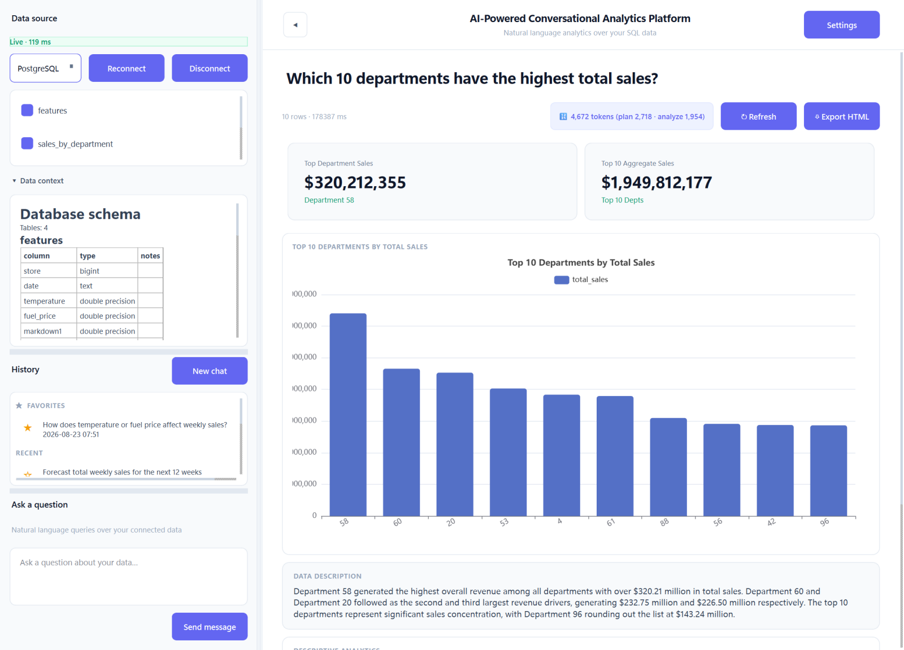
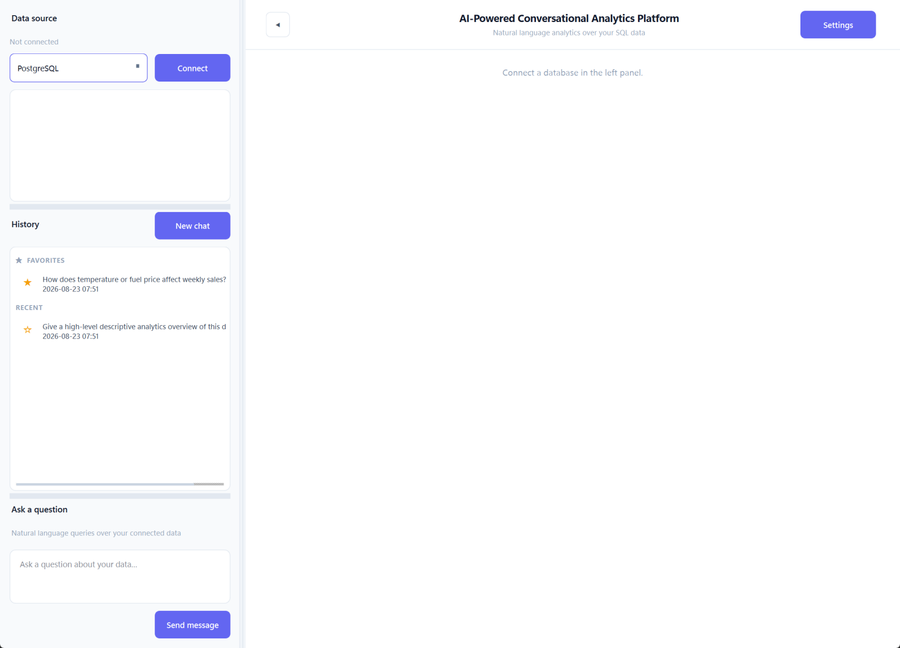
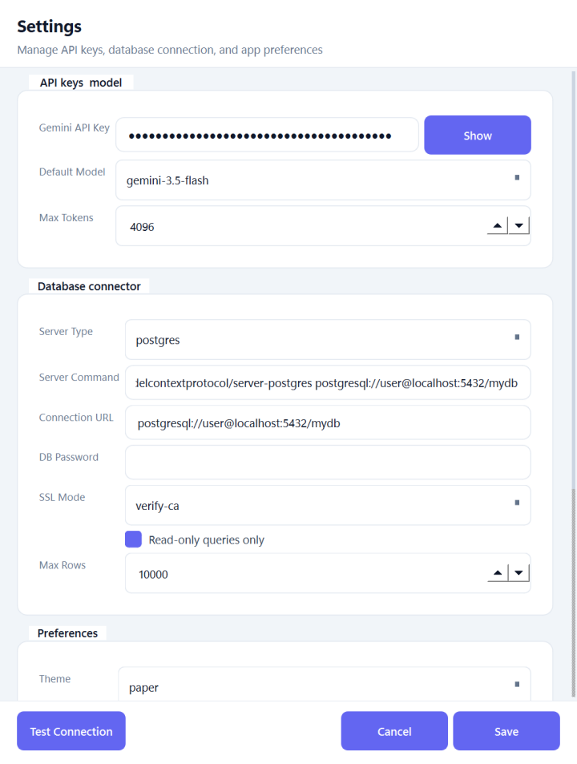
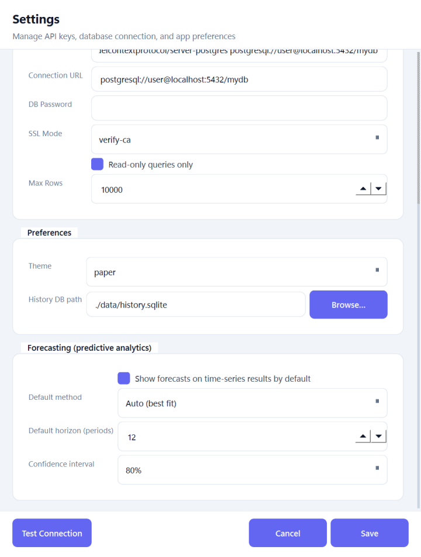
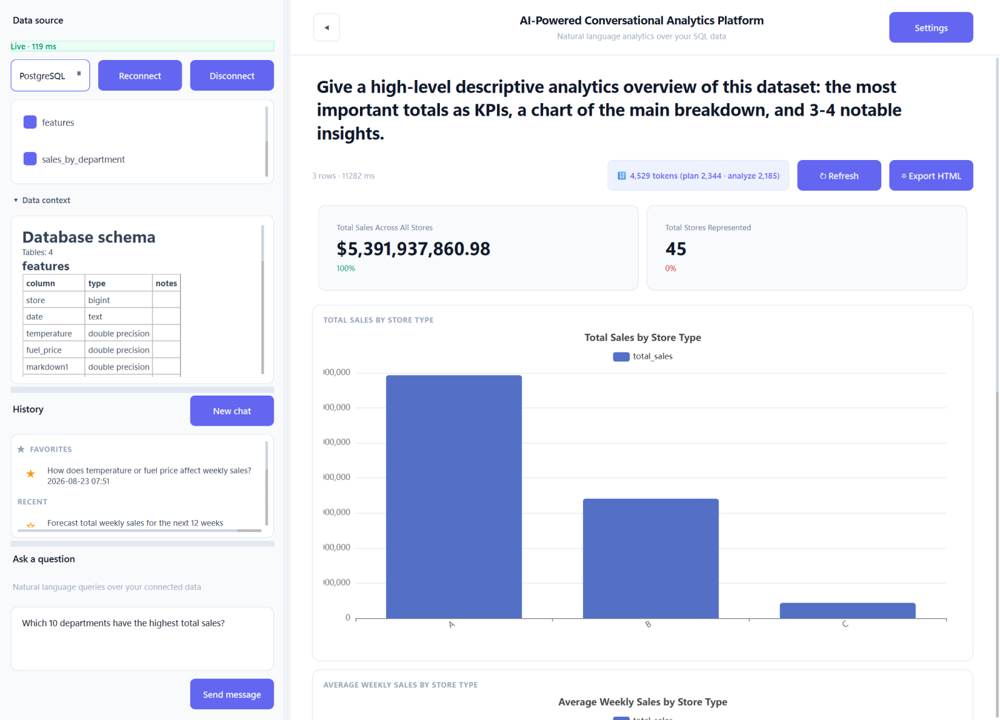
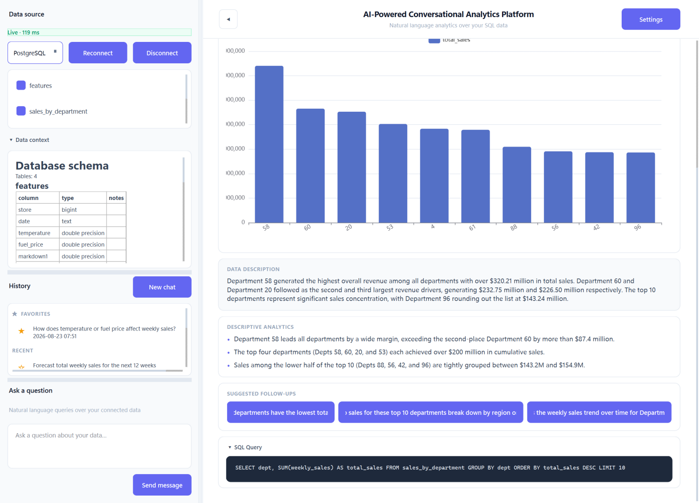
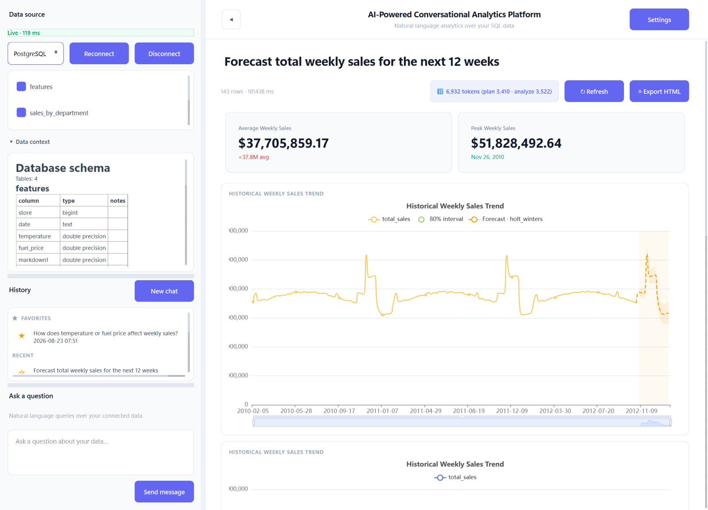
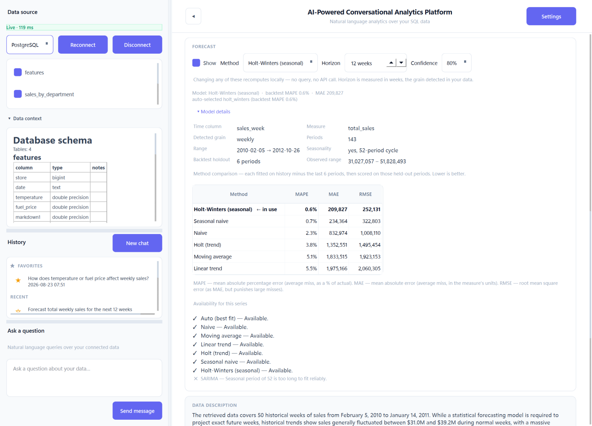
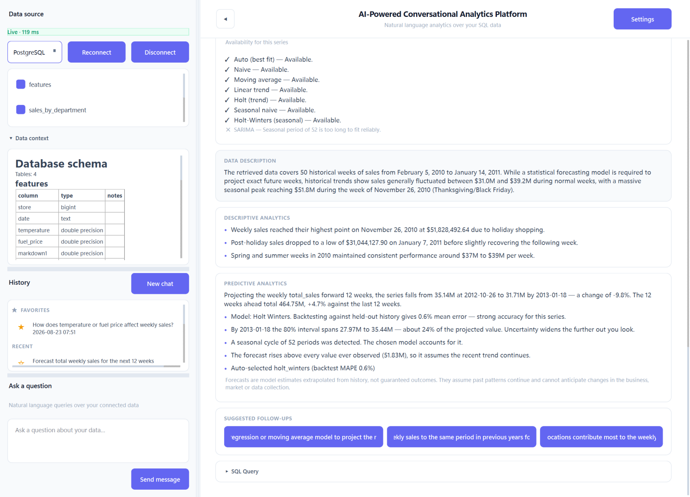

# AI-Powered Conversational Analytics Platform

[](LICENSE)


Ask questions about your SQL database in plain English and get back KPIs, an
interactive chart, a written analysis, and — when the answer is a time series —
a forecast computed on your machine.



**Your table data is never sent to the model.** Gemini sees the schema and, at
most, a compact sample of the query result. It writes the SQL and the prose;
every number on screen is computed in Python from the real rows.

---

## Contents

- [Features](#features)
- [How it works](#how-it-works)
- [Installation](#installation)
- [User guide](#user-guide)
  1. [Launch the app](#1-launch-the-app)
  2. [Configure settings](#2-configure-settings)
  3. [Load sample data and connect](#3-load-sample-data-and-connect)
  4. [Ask a question](#4-ask-a-question)
  5. [Read the answer](#5-read-the-answer)
  6. [Forecast a time series](#6-forecast-a-time-series)
  7. [History, favourites and export](#7-history-favourites-and-export)
  8. [Working across databases](#8-working-across-databases)
  9. [Keyboard shortcuts](#9-keyboard-shortcuts)
- [Database connectivity](#database-connectivity)
- [Building a distributable](#building-a-distributable)
- [Tests](#tests)
- [Troubleshooting](#troubleshooting)
- [Repository layout](#repository-layout)
- [Documentation](#documentation)
- [Contributing](#contributing)
- [License](#license)

---

## Features

- **Natural language to SQL.** Ask a question in English; the app writes a
  read-only `SELECT`, runs it, and explains the result.
- **Numbers you can trust.** KPIs and chart values are computed in Python from
  the rows the query returned. The model only decides *which* aggregation to
  show, never the value.
- **Interactive charts.** Apache ECharts with tooltips, zoom and click-to-drill
  down, bundled locally so they work offline.
- **Local forecasting.** When a result is a regular time series, the app
  projects it forward with one of seven methods, or picks the best one by
  backtest. No extra tokens, no extra queries.
- **Explainable models.** A *Model details* panel shows the detected grain,
  per-method error scores (MAPE / MAE / RMSE), and why each method was offered
  or withheld.
- **Read-only by default,** enforced at two independent points.
- **History that replays for free.** Every answer is saved locally, including
  its forecast, and reopens without any API or database call.
- **Provenance checks.** Each saved answer remembers which database produced it,
  and the app warns you before running a follow-up against a different one.
- **HTML export** of any analysis, including the forecast and a disclaimer.
- **Secrets in the OS keychain,** not in config files.

## How it works

Each question costs **two Gemini calls**. Connecting costs one more, once.

| Step | What the model receives | What it returns |
|---|---|---|
| **Connect** | Schema and 5 sample rows per table | A Markdown data dictionary (`data/context.md`) |
| **Plan** | Your question and the data dictionary (no rows) | A `SELECT`-only query and a chart intent |
| **Analyse** | At most 100 result rows / 4 KB | Narrative, KPI *specs*, chart specs, follow-up suggestions |

After that, with **zero tokens and no extra SQL**, Python fills the charts,
computes the KPI values from the real rows and, if the result is a time series,
attaches a forecast.

The design, with diagrams, is in [docs/ARCHITECTURE.md](docs/ARCHITECTURE.md).

---

## Installation

### Prerequisites

| Requirement | Notes |
|---|---|
| Windows 10/11 | The helper scripts are `.bat` files. The app itself is plain Python + Qt; `run_build.sh` covers Linux and macOS builds. |
| Python 3.10 or newer | Must be on `PATH`. Developed on 3.13. |
| A Google Gemini API key | Free from [Google AI Studio](https://aistudio.google.com/apikey). |
| PostgreSQL | Any reachable server, **or** Docker Desktop to run the bundled local one. |

### Set up

```bat
git clone https://github.com/PrakashShet/ConversationalAnalyticsPlatform.git
cd ConversationalAnalyticsPlatform
setup.bat                      :: creates .venv and installs requirements.txt
run.bat                        :: launches the app
```

`setup.bat` also copies `.env.example` to `.env`. You do not need to put your key
there — the app stores it in the OS keychain when you save it in **Settings**.

---

## User guide

### 1. Launch the app

Run `run.bat`. The window has three areas:



| Area | What it is for |
|---|---|
| **Data source** (top left) | Pick the database type, connect, and see the tables found. |
| **History** (middle left) | Every answer you have received, newest first. Star one to pin it under *Favorites*. |
| **Ask a question** (bottom left) | Type a question and press **Send message** or <kbd>Ctrl</kbd>+<kbd>Enter</kbd>. |
| **Canvas** (right) | The answer: KPIs, charts, narrative, forecast and the SQL that produced it. |

The **◀** button collapses the left panel when you want the canvas full width.

### 2. Configure settings

Click **Settings** (or press <kbd>Ctrl</kbd>+<kbd>,</kbd>).



1. **Gemini API Key** — paste your key. It is saved to the operating system's
   keychain (Windows Credential Manager on Windows), never to disk in plain
   text. **Show** reveals it while you check it.
2. **Default Model** — `gemini-3.5-flash` is the default and is fast and
   inexpensive; `gemini-3.5-pro` is slower and more thorough.
3. **Database connector** — set **Server Type** and the **Connection URL**, for
   example `postgresql://user@localhost:5432/mydb`. A password, if needed, goes
   in **DB Password** and is also kept in the keychain.
4. Leave **Read-only queries only** ticked unless you have a reason not to.
5. **Test Connection**, then **Save**.

Scroll down for **Preferences** (accent theme: *paper*, *ocean* or *emerald*)
and **Forecasting** defaults — the default method, horizon and confidence
level, and whether forecasts appear automatically.



### 3. Load sample data and connect

If you do not have a database to hand, run a local PostgreSQL in Docker and
load some CSVs into it:

```bat
run_postgres.bat               :: starts PostgreSQL 18 in Docker (data stored in data\pgdata)
download_public.bat            :: fetches public Superstore datasets into data\raw\public
load_data.bat data\raw         :: loads every CSV under data\raw into its own table
```

`load_data.bat` **wipes the target database first** unless you add `--keep`.
Column names are normalised to lowercase snake_case (`Order Date` →
`order_date`). Any CSV works — see [`input_data/README.md`](input_data/README.md)
for more sources, including the Walmart retail data used in these screenshots.

Now click **Connect**. The app introspects the schema, then makes two
background calls: one builds a **Data context** dictionary describing every
table (shown in the left panel), and one produces an opening overview of the
dataset on the canvas.


Expand **Data context** to read what the model was told about each table — it
is the only description of your data the planner ever sees.

### 4. Ask a question

Type a question in plain English and press **Send message**
(<kbd>Ctrl</kbd>+<kbd>Enter</kbd>).



Good questions name a measure and a breakdown or a time grain:

- *Which 10 departments have the highest total sales?*
- *Show weekly sales for store 20 in 2011.*
- *How does temperature or fuel price affect weekly sales?*
- *Forecast total weekly sales for the next 12 weeks.*

If a question cannot be answered from the connected schema, the app says so
and explains why instead of guessing.

### 5. Read the answer


From the top:

| Section | What it shows |
|---|---|
| **Meta bar** | Rows returned, time taken, and the Gemini tokens used (planner + analyst). **↻ Refresh** re-runs the question; **⇩ Export HTML** saves a report. |
| **KPI tiles** | Headline numbers, computed in Python from the returned rows. |
| **Chart** | Interactive: hover for values, and **click a bar or slice to drill into it** — the app asks a follow-up about that category. Line charts also zoom with the mouse wheel or the slider underneath. |

Scroll down for the written analysis:



| Section | What it shows |
|---|---|
| **Data Description** | A plain-language summary of the result. |
| **Descriptive Analytics** | The notable findings, as bullets. |
| **Suggested follow-ups** | One-click next questions. |
| **SQL Query** | Click to expand the exact query that ran — useful for checking the logic or reusing it elsewhere. |

### 6. Forecast a time series

When a result has a date or period column, a numeric measure, at least six
points and regular spacing, the app adds a forecast automatically. You can also
just ask for one: *"Forecast total weekly sales for the next 12 weeks"* fetches
the history and projects it locally — the database never needs future rows.



The chart shows history as a solid line and the projection as a dashed line
with a shaded confidence band.

**Forecast controls** sit under the chart:

| Control | Meaning |
|---|---|
| **Show** | Hide the projection and keep only the history. |
| **Method** | *Auto (best fit)* backtests every eligible method and keeps the most accurate. You can also choose Naive, Seasonal naive, Moving average, Linear trend, Holt, Holt-Winters or SARIMA — only methods valid for this series are listed. |
| **Horizon** | How far ahead to project, in the series' own unit (weeks, months, …). |
| **Confidence** | Width of the band: 80, 90 or 95 %. Wider means less precise, not more certain. |

Changing any control recomputes instantly on your machine — no query and no API
call. Expand **▸ Model details** to see how the model was chosen:



- **Series diagnostics** — detected grain, number of periods, date range,
  seasonality, backtest holdout, observed range.
- **Method comparison** — MAPE, MAE and RMSE for every eligible method, best
  first, with the one in use marked. This is what makes *Auto* auditable.
- **Availability** — why each method is offered or withheld for this series.

Below the descriptive section, a **Predictive Analytics** card explains the
forecast in words: direction and size of the change, the horizon total against
the previous equivalent window, which model was used and how accurate it was in
backtesting, how wide the uncertainty gets, and whether the projection leaves
the range ever observed.



This narrative is composed in Python from the forecast itself — it costs no
tokens, and the model is never asked to state a predicted number.

If you ask for a forecast and the result is not a time series, the app tells you
exactly why (no date column, too few periods, irregular spacing) rather than
quietly returning a descriptive answer.

`statsmodels` is optional: without it, Holt, Holt-Winters and SARIMA disappear
from the list and the numpy methods carry on. The mathematics of every method
is documented in the [forecasting report series](docs/reports/forecasting/README.md).

### 7. History, favourites and export

- **Replay.** Click any item under **History** to reopen it exactly as it was
  shown — charts, KPIs and forecast — with no API or database call.
- **Favourite.** Click the ☆ next to an item to pin it under *Favorites*.
- **New chat** (<kbd>Ctrl</kbd>+<kbd>N</kbd>) starts a fresh conversation.
  Recent questions are passed to the planner as context, so a new chat is
  useful when you change topic.
- **Export.** **⇩ Export HTML** on any answer writes a self-contained report
  with the KPIs, charts, narrative, SQL and — if present — the forecast table
  and a disclaimer.

History is stored locally in `data/history.sqlite`.

### 8. Working across databases

Every answer records which database produced it: the profile, the connection
URL (password removed) and a hash of the schema. If you reopen an old answer
while connected somewhere else and click one of its follow-ups, drill-downs or
**Refresh**, the app stops and tells you — the question was written for a
different schema, and answering it here would give a confident but unrelated
result. You can still proceed; the dialog names the source to reconnect to.

The schema hash matters as much as the URL: `load_data.bat` drops and recreates
the tables, so the same connection string can hold entirely different data.
Switching sources also starts a fresh conversation, so one database's history
never becomes context for another's SQL.

### 9. Keyboard shortcuts

| Shortcut | Action |
|---|---|
| <kbd>Ctrl</kbd>+<kbd>Enter</kbd> | Send the question |
| <kbd>Ctrl</kbd>+<kbd>,</kbd> | Open Settings |
| <kbd>Ctrl</kbd>+<kbd>N</kbd> | New conversation |
| <kbd>Esc</kbd> | Close Settings without saving |

---

## Database connectivity

| Type | Client | Notes |
|---|---|---|
| PostgreSQL | `DirectSqlClient` (SQLAlchemy + psycopg2) | Primary, fully supported. |
| MySQL | `DirectSqlClient` | Schema introspection is currently PostgreSQL-specific — see [known issues](docs/ARCHITECTURE.md#14-known-issues). |
| SQLite | `SyncMcpClient` (MCP stdio subprocess) | Requires `npx`. Seed a demo database with `python -m app.data.seed_sample_db`. |

Read-only mode is on by default and enforced at two independent points. Both
are prefix checks, so for an untrusted database also connect with a
genuinely read-only database role.

## Building a distributable

```bat
run_build.bat                  :: release build (windowed)
run_build.bat --debug          :: console build - startup errors visible
run_build.bat --fast           :: skip the dependency install step
```

`run_build.sh` does the same under Git Bash, Linux and macOS.

Output: `dist\ConvAnalytics\ConvAnalytics.exe`. **Ship the entire
`dist\ConvAnalytics\` folder**, including `_internal\` — the `.exe` alone will
not run. See [THIRD_PARTY_NOTICES.md](THIRD_PARTY_NOTICES.md) before
redistributing a build.

After every build the exe runs with `--selftest`, which imports every
dependency and checks every bundled asset without opening a window. You can run
it yourself:

```bat
cd dist\ConvAnalytics
ConvAnalytics.exe --selftest
```

### When the exe does nothing

A windowed build has no console, so a startup failure is invisible. Check, in
order:

| Check | Meaning |
|---|---|
| `data\logs\selftest.log` | A dependency or asset is missing from the bundle. |
| `data\logs\boot.log` | Python started; the failure is later than import. |
| `data\logs\crash.log` | Full traceback from an unhandled exception. |
| `data\logs\faulthandler.log` | A native crash inside Qt or Chromium. |
| No files at all | The process died before Python ran — almost always a missing DLL. Rebuild with `run_build.bat --debug --fast` and run the exe from a terminal. |

Full PyInstaller output is always written to `build\build.log`.

## Tests

```bat
test.bat
```

Covers `app/core` and `app/data`. Tests that call the live Gemini API skip
themselves unless `GEMINI_API_KEY` is set. The Qt UI layer is not covered by
automated tests.

---

## Troubleshooting

| Symptom | Fix |
|---|---|
| "Virtual environment not found" | Run `setup.bat` first. |
| "Not connected" when you ask | Click **Connect** in the Data source panel. |
| Invalid API key / 401 / 403 | **Settings** → re-enter the Gemini key. |
| Model not found (404) | **Settings** → pick another model from the list. |
| Connect fails for PostgreSQL | Is the server running? `run_postgres.bat` for the local one; check the URL in Settings and use **Test Connection**. |
| Connect fails for SQLite | Make sure `data/sample.db` exists: `python -m app.data.seed_sample_db`. |
| "Column not found" errors | Reload the CSVs with `load_data.bat`; columns are normalised to lowercase. |
| Charts are not interactive | Needs QtWebEngine: `pip install PySide6-Addons`. The app falls back to static charts. |
| No forecast appears | The result must have a date column, a numeric measure, at least 6 points and regular spacing. Ask for a time grain (*weekly*, *monthly*). |
| Answers are slow | Each question makes two Gemini calls; response time depends on the model and the API. |
| Nothing happens after Connect | Check `data/logs/app.log`. |

> **Sharing logs.** Current builds never write variable values into
> `data/logs/app.log`, so your API key stays out of tracebacks. Logs written by
> builds before November 2026 could contain it — delete those, or search them
> for `AIza` before sharing.

---

## Repository layout

```
app/
  config/       settings (JSON in the user config dir) and OS-keychain access
  core/         the engine: planner, analyst, SQL clients, forecasting — no Qt
  data/         models, history DB, CSV loader, dataset downloaders
  resources/    prompts (Markdown) and the vendored ECharts bundle
  ui/           main window, panels, dialogs, charts, background workers
docs/
  ARCHITECTURE.md   design, diagrams, known issues
  images/           screenshots used in this README
  plans/            historical design notes
  reports/          forecasting technical report series
input_data/     drop CSVs here for load_data.bat (not committed)
tests/          pytest suite for app/core and app/data
.githooks/      pre-commit secret guard (enable with git config core.hooksPath .githooks)
*.bat           setup / run / test / load_data / run_postgres / run_build / download_*
```

## Documentation

| Document | Covers |
|---|---|
| [docs/ARCHITECTURE.md](docs/ARCHITECTURE.md) | Design principles, component map, pipeline, threading, persistence, provenance, security, known issues. |
| [docs/reports/forecasting/](docs/reports/forecasting/README.md) | Five reports on the forecasting subsystem: architecture, the mathematics of each method, the relevance gate, parameter selection, backtesting. |
| [docs/README.md](docs/README.md) | Index of all documentation. |

## Contributing

Issues and pull requests are welcome. Once per clone, turn on the secret guard:

```bat
git config core.hooksPath .githooks
```

It refuses any commit that contains an API key (Gemini/Google, GitHub,
Anthropic, OpenAI), a private key, the `GEMINI_API_KEY` from your local `.env`,
or a file that can hold secrets (`.env`, logs, the history database). It names
the file, never the value. GitHub push protection is also enabled on this
repository as a second line of defence.

Before opening a PR:

1. Run `test.bat` and make sure it passes.
2. Keep `app/core` free of Qt imports — that separation is what makes the
   engine testable.
3. Never send table data to the model, and never let the model produce a number
   that is shown to the user. See the
   [design principles](docs/ARCHITECTURE.md#1-design-principles).
4. If behaviour changes, update `docs/ARCHITECTURE.md` (including its diagrams)
   in the same PR.

## License

Released under the [MIT License](LICENSE). Copyright © 2026 Prakash Shet.

Third-party components keep their own licenses — notably Apache ECharts
(Apache-2.0, vendored) and Qt for Python (LGPL-3.0). See
[THIRD_PARTY_NOTICES.md](THIRD_PARTY_NOTICES.md).

This project uses the Google Gemini API; your use of it is subject to
Google's terms. Questions, schema details and result samples are sent to the
API as described in [How it works](#how-it-works).
