# Architecture

AI-Powered Conversational Analytics Platform — a PySide6 desktop application
that answers natural-language questions about a SQL database and, when the
result is a genuine time series, adds a locally computed forecast.

---

## 1. Design principles

The whole architecture follows from four rules:

| # | Principle | Consequence in the code |
|---|---|---|
| 1 | **Never send table data to the LLM.** | The planner sees only a schema summary. The analyst sees at most ~100 rows / 4,000 characters (`row_utils.compact_rows`). |
| 2 | **The LLM writes SQL and prose — never numbers.** | KPIs are recomputed in Python from real rows (`row_utils.compute_kpis`). Forecasts are pure numpy/statsmodels (`core/forecasting.py`), and the predictive narrative is composed in Python (`core/forecast_narrative.py`). |
| 3 | **Read-only by default.** | Two independent gates: `row_utils.is_select_only` before execution and `DirectSqlClient.query`'s prefix check at the driver. |
| 4 | **Degrade, never crash.** | Optional `statsmodels`, optional QtWebEngine, JSON repair-retry, CSV encoding fallbacks, forecast failures leave the descriptive answer intact. |

---

## 2. Component map

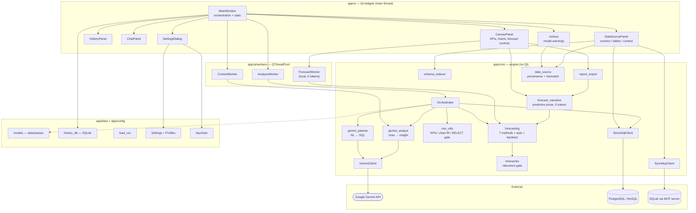

### Package responsibilities

| Package | Rule |
|---|---|
| `app/core` | Pure engine. **No Qt imports.** Unit-testable in isolation. |
| `app/data` | Dataclasses, SQLite history, CSV ingestion, column normalisation. |
| `app/config` | Settings persistence (JSON, `platformdirs`) and OS keychain access. |
| `app/ui` | Widgets, dialogs, charts. Holds no business logic beyond presentation. |
| `app/ui/workers` | `QRunnable` bridges — the only place where core meets threads. |
| `app/resources` | Prompt Markdown files and the vendored `echarts.min.js`. |

---

## 3. The three-step pipeline

The heart of the app is `Orchestrator.ask()`. One question costs **exactly two
Gemini calls** (plus a one-off context build at connect time).

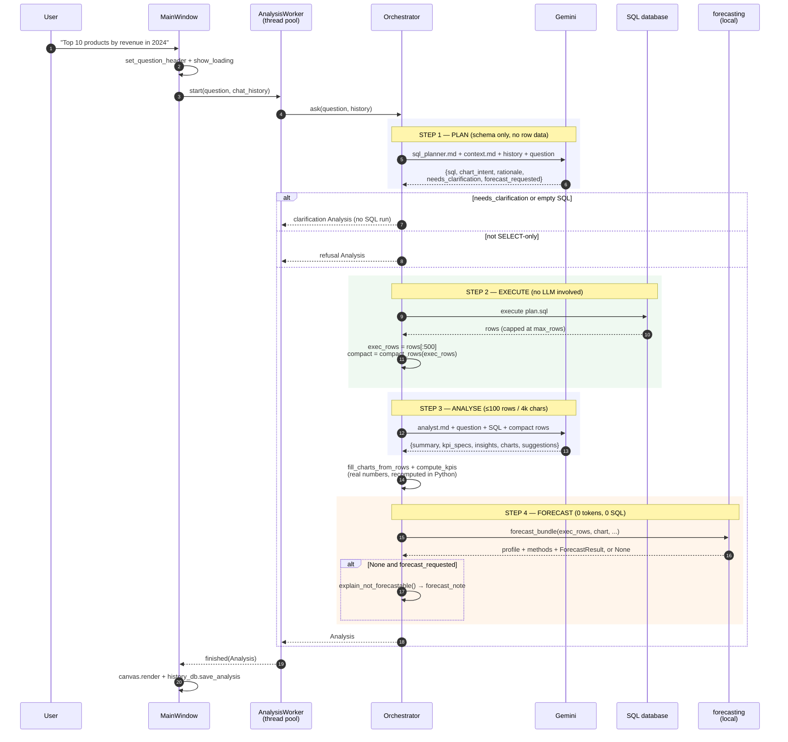

### Why this is cheap

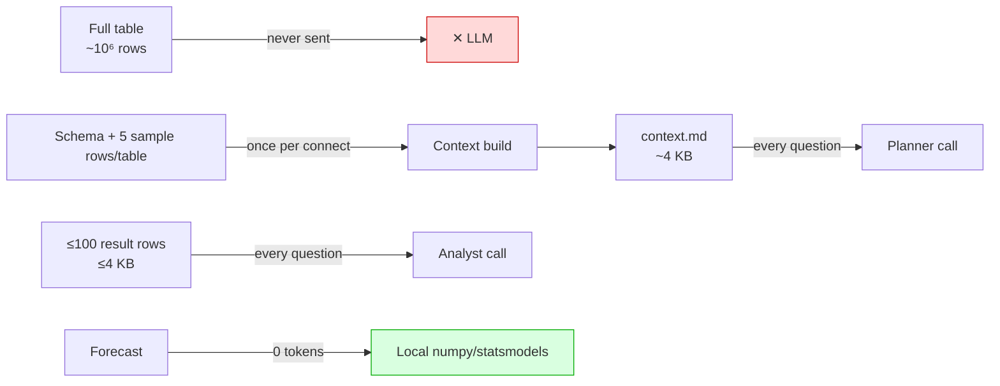

---

## 4. Connection lifecycle

Connections are generational. Every connect/disconnect bumps
`MainWindow._connection_gen`, and workers carry the generation they were born
in — so results from an abandoned connection are dropped instead of crashing
against a closed SQL client.

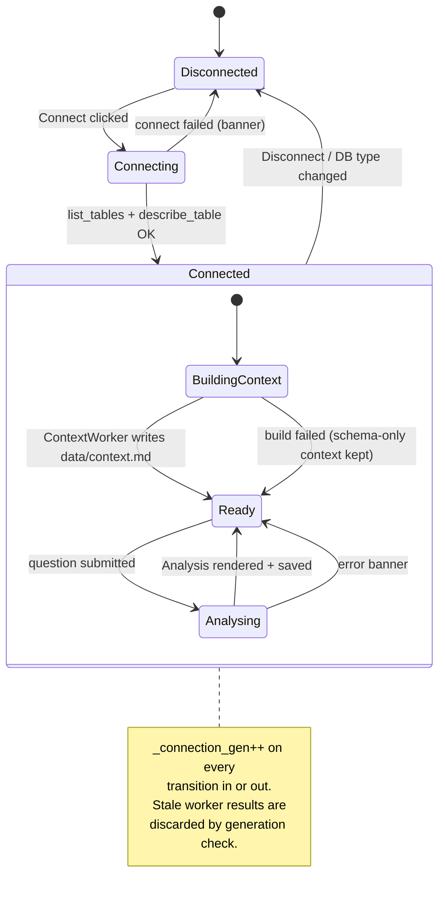

Two things happen the moment a connection succeeds:

1. **`ContextWorker`** asks Gemini to turn schema + sample rows into a rich
   Markdown data dictionary, cached at `data/context.md`.
2. **`_run_default_analytics()`** immediately fires a canned overview question
   so the canvas is never empty.

---

## 5. Data access: two clients, one interface

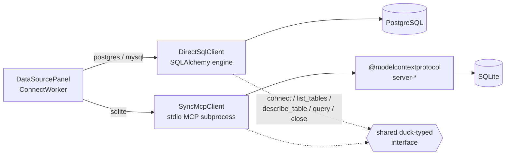

Both classes expose the same five methods, so the `Orchestrator` does not care
which it holds. The MCP path exists because it was the original design; the
direct path was added because spawning `npx` subprocesses on Windows proved
fragile.

> **Naming caveat:** the type hints still say `SyncMcpClient`
> (`Orchestrator.__init__`, `DataSourcePanel._client`) even though the Postgres
> and MySQL paths pass a `DirectSqlClient`. Read those annotations as
> "SQL client", not as a literal type.

---

## 6. Predictive analytics — the relevance gate

> **Full treatment:** this section summarises the subsystem. The mathematics of
> each method, the detection rules, parameter semantics and the evaluation
> procedure are documented in the
> [forecasting report series](reports/forecasting/README.md).

Forecast controls appear **only** on data that is genuinely a time series.
`timeseries.detect_time_series` is the gate; it returns `None` for anything
else, and `None` means the forecast layer is silently skipped.

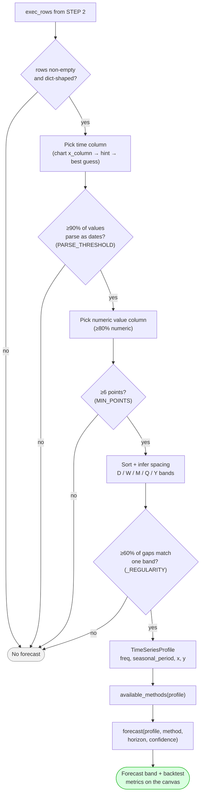

### Forecast questions are first-class

"Get me weekly sales" and "get me a sales forecast" must produce substantially
the same SQL. The planner prompt states this outright, because the model's
instinct is otherwise to refuse a forecast on the grounds that the database
holds no future rows — which is true and irrelevant, since the app forecasts
locally from the history the SQL returns.

`SqlPlan.forecast_requested` records that the user asked. It changes nothing
about the SQL; it means that if detection then fails, the app owes an
explanation rather than a silently descriptive answer.
`timeseries.explain_not_forecastable()` produces it — naming the missing date
column, the period count that fell short of six, or the irregular spacing — and
it surfaces both as a modal and as a card in place of the predictive section.

### Method availability is data-driven

| Method | Offered when | Engine |
|---|---|---|
| `auto` | always (picks the best by backtest) | — |
| `naive` | always | numpy |
| `moving_average` | always | numpy |
| `linear_trend` | always | numpy |
| `holt` | `n_points ≥ 6` | statsmodels |
| `seasonal_naive` | series is seasonal | numpy |
| `holt_winters` | series is seasonal | statsmodels |
| `sarima` | `seasonal_period ≤ 24` and `n_points ≥ max(2·period, 16)` | statsmodels |

Seasonal periods by frequency: `D→7`, `W→52`, `M→12`, `Q→4`, `Y→none`.
Confidence bands use hardcoded z-scores (`0.80→1.2816` … `0.99→2.5758`) to
avoid a SciPy dependency. If `statsmodels` is missing, the statistical methods
disappear from the list and the numpy methods carry on.

### Transparency: the “Model details” panel

`Auto` picking a method invisibly is a black box, so everything behind it is
inspectable in a collapsible panel under the Forecast controls. All of it is
local arithmetic over history already in memory.

| Section | Source | Shows |
|---|---|---|
| Series diagnostics | `series_diagnostics()` | Time column, measure, detected grain, period count, date range, seasonality, backtest holdout, observed range |
| Method comparison | `compare_methods()` | MAPE / MAE / RMSE for every eligible method, sorted best-first, with the one in use marked |
| Availability | `method_availability()` | Every known method with why it is offered or withheld — too few points, not seasonal, statsmodels absent, seasonal period too long |
| Parameter help | `METHOD_NOTES`, tooltips | What each method assumes; horizon in the series' own units; what a confidence band means |

The comparison table is what makes `Auto` auditable: its winner must be the top
scored row, and a test asserts exactly that.

### Predictive analytics narrative

Whenever a forecast exists, a **Predictive Analytics** card renders beneath
**Descriptive Analytics**, in the same shape — a summary paragraph then
bullets. `app/core/forecast_narrative.py` composes it in Python: direction and
size of change, horizon total against the prior equivalent window, which model
and its backtest accuracy in words, band width at the far end, whether
seasonality is present and whether the chosen model uses it, and whether the
projection leaves observed territory.

**This costs zero tokens and no Gemini call.** That is not only economy — rule
two says the LLM never states a predicted number, and the surest way to hold
that line is to never ask it to. Being deterministic, the prose is also
assertable in tests, and the HTML export renders the identical text so a report
and the screen cannot disagree.

### Recompute is free

Changing method, horizon, or confidence dispatches a `ForecastWorker` that
re-runs `forecasting.forecast()` over the in-memory `TimeSeriesProfile`.
**No Gemini call. No SQL. No network.** Results are memoised in
`forecasting._CACHE`.

---

## 7. Data model

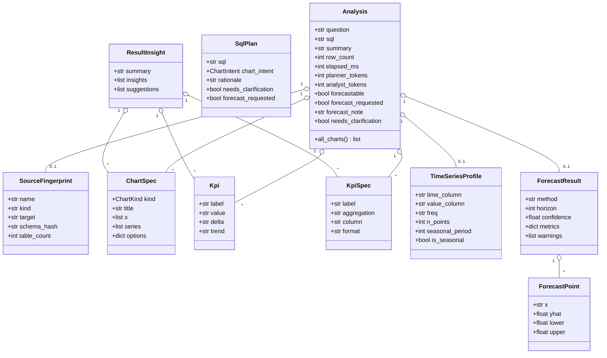

`KpiSpec` vs `Kpi` is the key distinction: the LLM emits a **spec**
(`{label, aggregation, column, format}`), and Python computes the **value** from
real rows. The model never states a figure that wasn't calculated.

---

## 8. Threading model

Everything expensive runs on `QThreadPool.globalInstance()`; only signal
handlers touch widgets.

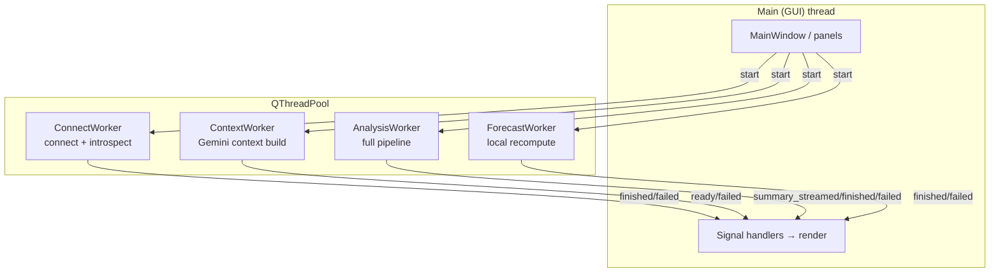

Three safety mechanisms are worth knowing about:

- **Generation guard** — each worker stores `connection_gen` and an `is_current`
  callback; stale emissions are dropped.
- **Parented signal objects** — `WorkerSignals(parent)` keeps the `QObject`
  alive for the runnable's lifetime.
- **`RuntimeError` swallowing** — emitting to a deleted receiver is logged at
  debug level rather than crashing.

---

## 9. Persistence

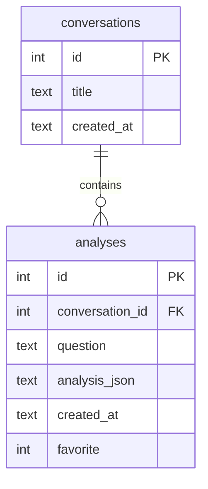

The `Analysis` is serialised to JSON in `analysis_json`, so replaying a history
item re-renders the canvas with **zero API calls and zero SQL**. `init_db`
performs an inline migration adding `favorite` to older databases.

The two halves of an analysis are stored differently — deliberately:

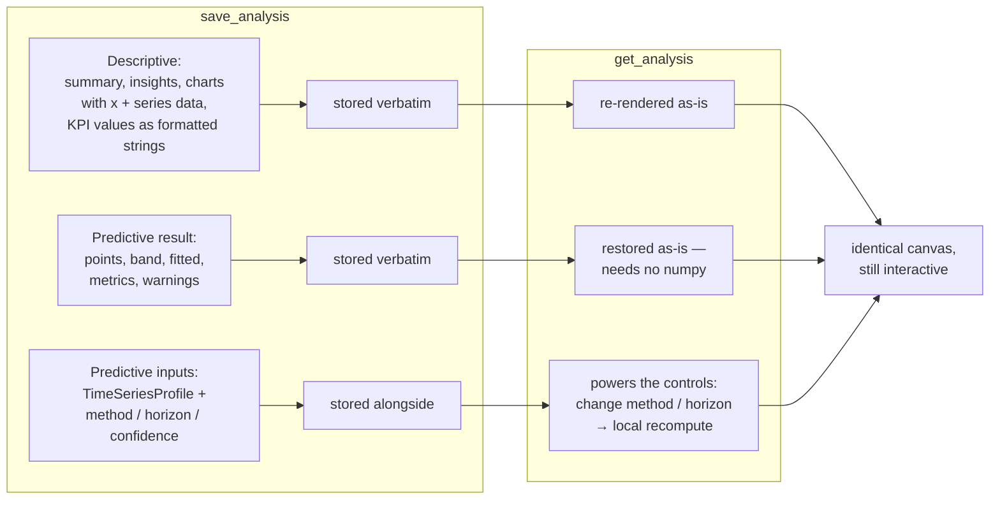

**Descriptive** results are stored verbatim: chart `x`/`series` data is embedded
and KPIs are stored as the already-computed formatted strings, so replay never
recomputes a number that was shown to the user.

**Predictive** results are stored the same way, and then some. The full
`ForecastResult` — every point, confidence band, fitted value, backtest metric
and warning — is persisted under `forecast`, so the record of what the user
actually saw is authoritative and cannot drift if the forecasting code changes
later. Rebuilding it requires nothing but the stored dicts, so history replays
even where numpy is unavailable.

Its *inputs* are stored alongside: the `TimeSeriesProfile`, the **resolved**
method (`auto` has already collapsed to what the backtest chose), horizon,
confidence, and `available_methods`. Those are what keep the forecast controls
live — changing method or horizon on a replayed item recomputes locally against
the stored profile, exactly as on a fresh result. Total predictive payload is
about 2.6 KB for a 36-point series with a 12-period horizon.

| Situation | Behaviour |
|---|---|
| Result + inputs present | Result restored verbatim; controls interactive |
| Inputs only (older payload) | Forecast recomputed — deterministic, so identical |
| Result only, no profile | Forecast displayed; `forecastable=False`, controls hidden |
| Neither | Descriptive-only replay |
| Malformed profile or points | Degrades to descriptive-only; never raises |

Each payload also carries `source` (the `SourceFingerprint`, password-free), `needs_clarification`, and `forecast_requested` / `forecast_note` — so a replayed analysis explains a missing forecast exactly as the live one did.

NaN metrics (returned by `backtest` on series too short to score) are written as
`null` — bare `NaN` is not valid JSON. Both consumers, `report_export` and
`canvas_panel._set_forecast_badge`, already guard on `None` before their NaN
check. All of the above is covered by `tests/test_history_db.py`.

| What | Where |
|---|---|
| Settings (non-secret) | `platformdirs.user_config_dir("conv-analytics")/config.json` |
| Gemini API key | OS keychain, service `conv-analytics` |
| Conversation history | `data/history.sqlite` |
| Data dictionary | `data/context.md` |
| Logs | `data/logs/app.log` (1 MB rotation, 5 kept), `crash.log` |

---

## 10. Data-source provenance

A saved analysis outlives the connection that produced it. Its suggested
follow-ups, drill-downs and Refresh button are all questions written against
*that* database's schema — so running them against whatever happens to be
connected now would produce a confident, unrelated answer.

Every `Analysis` therefore carries a `SourceFingerprint`, computed at connect
time from the active profile plus the schema just introspected:

| Field | Purpose |
|---|---|
| `name`, `kind` | Profile label and engine, for the dialog wording |
| `target` | Connection URL, **password redacted** — fingerprints are persisted |
| `schema_hash` | 12-hex digest of sorted `table(column,…)` names |
| `table_count` | Displayed in the dialog |

`schema_hash` deliberately ignores column *types* and result ordering, so a
widening `int4 → int8` is not a change, but a renamed column is. That makes it
catch the case a URL comparison misses: `load_data.bat` drops and recreates the
public schema, so the same URL can hold entirely different data.

```mermaid
flowchart TD
    A["User clicks a suggested follow-up,<br/>drill-down, or Refresh"] --> B{"Connected?"}
    B -->|no| N1["Modal: Not connected"]
    B -->|yes| C["compare(displayed.source, live.source)"]
    C -->|None| G["Run the question"]
    C -->|different_target| M1["Modal: belongs to another database<br/>names both, says how to reconnect"]
    C -->|schema_changed| M2["Modal: data reloaded since save"]
    C -->|unknown_source| M3["Modal: no provenance recorded"]
    M1 & M2 & M3 --> D{"Ask anyway?"}
    D -->|Cancel<br/>(default)| X(["Nothing runs"])
    D -->|Ask anyway| G
    G --> H{"API key set?"}
    H -->|no| N2["Modal: API key required<br/>→ Open Settings"]
    H -->|yes| I["AnalysisWorker"]
    I -->|needs_clarification| N3["Modal: question doesn't fit this data"]
    I -->|exception| N4["Modal: classified failure"]
    I -->|ok| R(["Rendered"])

    style X fill:#f2f2f2,stroke:#999
    style R fill:#d9ffe0,stroke:#0a0
```

The gate applies only to questions **derived from what is on screen**. A
question typed into the chat box is a new question about the current data and
passes straight through. Cancel is the default button — the safe choice needs
no thought — but the mismatch is a warning, not a block, since the question may
still be valid against the new schema.

`app/core/data_source.py` holds the logic and, deliberately, the dialog
*wording* (`explain()`), so the copy is testable without Qt.
`app/ui/dialogs/notices.py` is the thin Qt layer.

### Session state is per–data source

Switching databases resets more than the connection. `_reset_session_state`
also clears `_chat_history` and opens a new conversation, because:

- chat history is fed to the planner as conversation context — DB A's Q&A would
  otherwise shape DB B's SQL;
- `_current_conv_id` would otherwise file results from two databases under one
  conversation in the history panel.

This fires on disconnect, on database-type change, and on a reconnect whose
fingerprint differs from the previous one.

---

## 11. Rendering

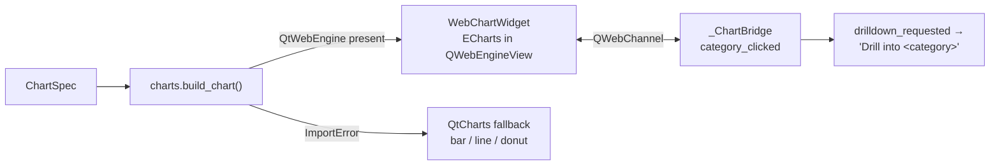

### Theming and dialog contrast

`theme.py` applies a fully-specified light `QPalette` **before** the stylesheet.
The palette is the floor for widgets `styles.qss` never names — message boxes,
menus, popups — and the stylesheet overrides it wherever it does.

This matters because dialogs are separate top-level windows and inherit nothing
from the `QMainWindow` rule. Without explicit colours they fall through to the
operating system palette, so on a dark-mode Windows a `QMessageBox` rendered
near-white text on its light surface and was unreadable. `styles.qss` now names
`QDialog`, `QMessageBox`, and Qt's internal `qt_msgbox_label` /
`qt_msgbox_informativelabel`.

The three accent themes remap only the indigo family; surface and text colours
are deliberately outside that map, so contrast cannot be broken by a theme
switch.

ECharts is **vendored** at `app/resources/vendor/echarts.min.js` — the app makes
no CDN calls and renders offline. Clicking a category in a chart emits a
drill-down that becomes the next natural-language question.

---

## 12. Packaging

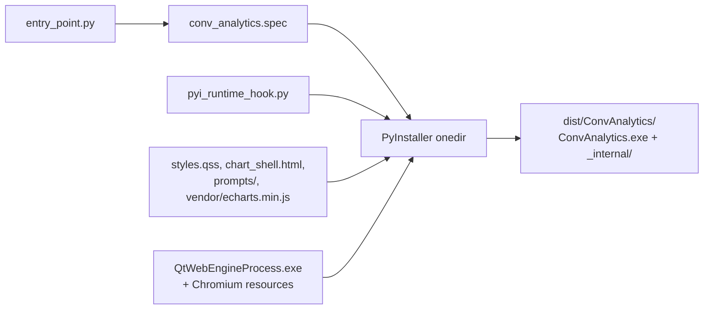

`app/paths.py` is the single source of truth for path resolution:

| Function | Dev | Frozen |
|---|---|---|
| `app_dir()` | repo root | folder containing the `.exe` |
| `bundle_dir()` | repo root | `sys._MEIPASS` |
| `resource_path(*p)` | `<repo>/app/...` | `<_MEIPASS>/app/...` |

`ensure_app_cwd()` chdirs beside the executable when frozen so relative `data/`
paths behave. Ship the **entire** `dist/ConvAnalytics/` folder — the `.exe`
alone will not run.

---

## 13. Security boundaries

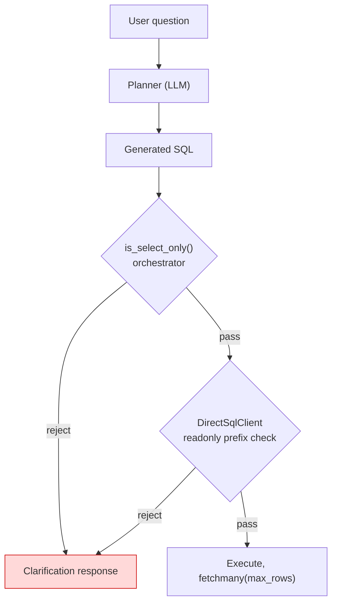

| Control | Where | Strength |
|---|---|---|
| SELECT/WITH-only | `row_utils.is_select_only` | prefix check |
| Read-only client | `DirectSqlClient.query` | prefix check |
| Row cap | `fetchmany(max_rows)`, default 10,000 | hard |
| Secrets | OS keychain via `app/config/keychain.py` | good |
| No table data to LLM | by construction | strong |

Both SQL gates are **prefix checks**, not parsers. For an untrusted database,
back them with a genuinely read-only database role — that is the only control
that cannot be talked around.

---

## 14. Known issues

Carry these forward; they are real and currently unfixed.

| # | Issue | Location |
|---|---|---|
| 1 | KPIs are computed over `exec_rows` (first 500) while `row_count` reports the full result — a `sum` over a larger result silently under-reports. | `app/core/orchestrator.py` (`MAX_EXEC_ROWS`) |
| 2 | `list_tables`/`describe_table` hardcode `table_schema = 'public'` (Postgres-only) although MySQL is offered in the UI. | `app/core/sql_client.py` |
| 3 | `describe_table` interpolates the table name into SQL with an f-string. | `app/core/sql_client.py` |
| 4 | Type hints say `SyncMcpClient` where a `DirectSqlClient` is actually passed. | `orchestrator.py`, `data_source_panel.py` |
| 5 | `fill_chart_from_rows` calls `float(...)` unguarded — a non-numeric y-column raises `ValueError` mid-render. | `app/core/row_utils.py` |
| 6 | The file log sink keeps loguru's default `diagnose=True`, so `logger.exception` tracebacks print local variables — including the Gemini request's `x-goog-api-key` header — into `data/logs/app.log`. Treat logs as secret until fixed (`diagnose=False` on the sink). | `app/main.py` (`_configure_logging`) |

**Fixed:** saved analyses had no record of which database produced them, so
clicking a suggested follow-up on a replayed item silently ran it against
whatever was connected — and `_chat_history` was never cleared on a source
change, feeding one database's Q&A into another's planner prompt. Analyses now
carry a `SourceFingerprint` and derived questions are gated by a modal (§10).

**Fixed:** history persistence previously dropped the entire predictive layer —
`forecastable`, `ts_profile`, `available_methods` and `forecast` were never
serialised, so replaying a history item silently lost the forecast while the
export path still emitted one. The computed result is now stored verbatim
alongside its inputs (§9), with round-trip coverage in
`tests/test_history_db.py`.

---

## 15. Repository layout

```
ConversationalAnalyticsPlatform/
├── app/
│   ├── config/      settings.py, keychain.py
│   ├── core/        orchestrator, gemini_*, sql_client, mcp_client,
│   │                timeseries, forecasting, forecast_narrative,
│   │                row_utils, report_export, data_source, schema_indexer
│   ├── data/        models.py, history_db.py, load_csv.py, download_*.py
│   ├── resources/   prompts/*.md, vendor/echarts.min.js
│   ├── ui/          main_window, widgets/, charts/, workers/,
│   │                dialogs/ (settings_dialog, notices)
│   ├── main.py      entry point
│   └── paths.py     dev vs frozen path resolution
├── docs/
│   ├── ARCHITECTURE.md   this file
│   ├── plans/            historical design plans + diagnostics
│   ├── tools/            docs build: mermaid_render, build_reports_docx
│   └── reports/          forecasting/ report series (+ docx), EMBA drafts
├── tests/           pytest suite (core only; UI is not covered)
├── input_data/      sample CSVs for load_data.bat
├── data/            context.md, history.sqlite, logs/, pgdata/
├── conv_analytics.spec   PyInstaller spec
└── *.bat            setup / run / test / load_data / run_build
```
