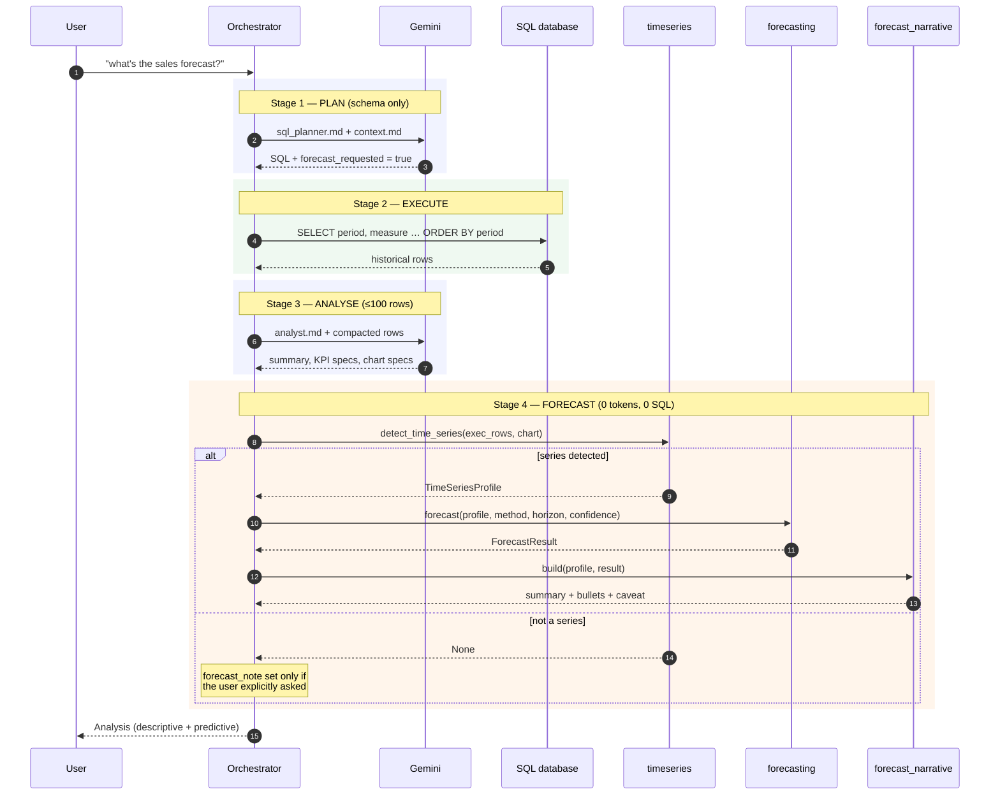
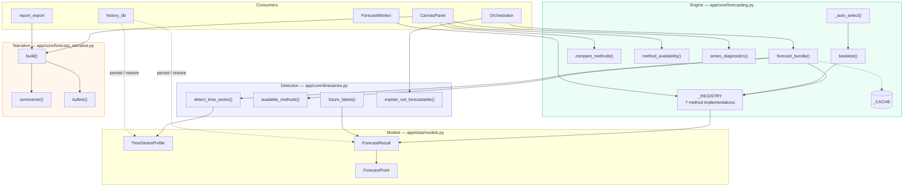
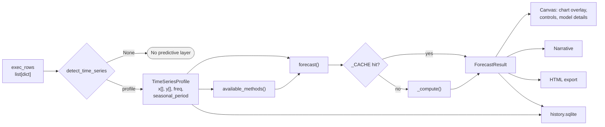
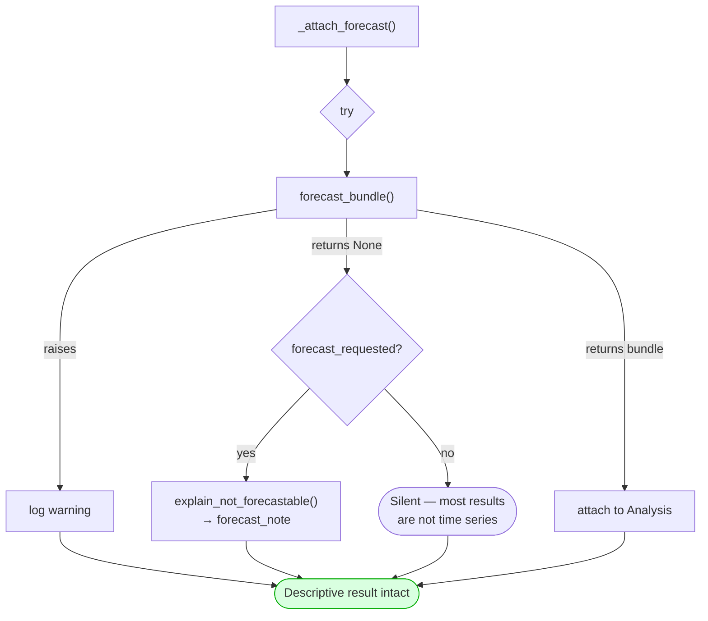

# Report 1 — Forecasting Architecture

**AI-Powered Conversational Analytics Platform**
Technical report series on the predictive-analytics subsystem.

---

## 1. Purpose and scope

This report describes the structure of the forecasting subsystem: where it sits
in the application, why it is isolated from the language model, and how a
forecast travels from SQL result rows to rendered chart, narrative and export.

The mathematics of individual methods is deferred to
[Report 2 — Method Reference](02-method-reference.md); detection rules to
[Report 3](03-relevance-gate.md); parameter semantics to
[Report 4](04-parameter-selection.md); evaluation to [Report 5](05-backtesting.md).

---

## 2. Design position

### 2.1 The separation of concerns

The platform combines a large language model with a statistical forecasting
engine. The central architectural decision is that these two never overlap:

| Concern | Owner | Rationale |
|---|---|---|
| Translating a question into SQL | Gemini | Natural-language understanding |
| Narrating descriptive results | Gemini | Fluent prose over observed rows |
| Computing every displayed figure | Python | Arithmetic must be verifiable |
| Producing forecasts | numpy / statsmodels | Predictions must be reproducible |
| Narrating forecasts | Python | See §2.2 |

The language model is never asked to predict a value, and never asked to restate
one. This is not a performance optimisation; it is a correctness property. A
generative model asked to report a number may round it, reformat it, or produce
a plausible neighbour of it, and no output-side validation can reliably detect
this. The defence is structural: the model is never given the opportunity.

### 2.2 Why the narrative is also computed

An intuitive design would compute the forecast numerically and then ask the
model to describe it. This was rejected. Passing a forecast to a generative
model for description reintroduces exactly the failure mode §2.1 eliminates —
the model must restate figures it did not compute.

`app/core/forecast_narrative.py` therefore composes the predictive-analytics
prose arithmetically from the `ForecastResult` and its `TimeSeriesProfile`.
Consequences:

- **Determinism.** Identical inputs yield identical prose, so the text is
  assertable in unit tests (`tests/test_forecast_narrative.py`).
- **Zero marginal cost.** No API call, so forecasting is free at any volume.
- **Offline capability.** The predictive layer functions with no network.
- **Export parity.** `report_export` renders the same generated text, so an
  exported document cannot disagree with the screen.

The cost is expressive range: the prose follows a fixed rhetorical structure
rather than adapting to context. For a quantitative report this is arguably a
virtue, since the reader learns where to look.

---

## 3. Position in the request pipeline

A forecast is the fourth stage of a four-stage pipeline, and the only stage that
consumes neither tokens nor a database round-trip.



The critical property is that stage 4 **reuses the rows already fetched in stage
2**. It issues no second query. A user who changes the forecasting method
afterwards triggers neither a database round-trip nor an API call.

---

## 4. Module structure



### 4.1 Module responsibilities

| Module | Depends on | Must never import |
|---|---|---|
| `timeseries.py` | pandas, numpy, `data.models` | Qt, statsmodels, any LLM client |
| `forecasting.py` | numpy, `timeseries`, optional statsmodels | Qt, any LLM client |
| `forecast_narrative.py` | numpy, `forecasting`, `data.models` | Qt, any LLM client |
| `report_export.py` | `forecast_narrative` | Qt |
| `ui/workers/forecast_worker.py` | Qt, `forecasting` | — |

The prohibition on Qt is what makes the entire subsystem testable in a headless
environment. The prohibition on LLM clients is what enforces §2.1 mechanically
rather than by convention: a module that cannot import a client cannot call one.

### 4.2 Optional dependency handling

`statsmodels` is imported inside a `try` block at module load:

```python
try:
    from statsmodels.tsa.holtwinters import ExponentialSmoothing, Holt
    from statsmodels.tsa.statespace.sarimax import SARIMAX
    _HAS_STATSMODELS = True
except Exception:
    _HAS_STATSMODELS = False
```

`supported_methods()` reflects the flag, so Holt, Holt-Winters and SARIMA simply
disappear from the offered list when the package is absent. Any request for them
degrades to `linear_trend` with a recorded warning. The application therefore
runs — with reduced method coverage — on a minimal install.

`numpy` is a hard requirement of the engine. `history_db` imports `forecasting`
*lazily*, inside the restore function, so conversation history remains readable
even where numpy is unavailable.

---

## 5. Data flow and object lifecycle



### 5.1 `TimeSeriesProfile` — the normalised series

Detection output, and the sole input to every method. It is a *cleaned* series,
not the raw rows: same-period rows summed, ordered ascending, non-parsing rows
dropped, period labels canonicalised.

| Field | Meaning |
|---|---|
| `time_column`, `value_column` | Which result columns were selected |
| `freq` | One of `D`, `W`, `M`, `Q`, `Y` |
| `n_points` | Number of distinct periods |
| `x`, `y` | Aligned labels and values, ascending |
| `seasonal_period` | Cycle length for the frequency, or `None` |
| `is_seasonal` | Whether at least two full cycles are present |

### 5.2 `ForecastResult` — the output record

| Field | Meaning |
|---|---|
| `method` | The **resolved** method (`auto` already collapsed) |
| `horizon`, `confidence` | Parameters used |
| `points` | `ForecastPoint(x, yhat, lower, upper)` per period |
| `fitted` | In-sample fit aligned to history, for chart continuity |
| `metrics` | `{mae, rmse, mape}` from backtesting |
| `warnings` | Auto-selection notes, degradations, fallbacks |

That `method` holds the resolved rather than requested value matters for
persistence: replaying a saved analysis reproduces the exact model used, not a
fresh selection that might differ if the data or code changed.

### 5.3 Memoisation

`forecast()` keys `_CACHE` on the tuple

```
(tuple(y), freq, last_label, seasonal_period, method, horizon, round(confidence, 4))
```

and clears wholesale past 128 entries. The values are the sole determinants of
`_compute`, so the cache cannot serve a stale result. It exists so that toggling
a control back and forth is instant, and so the model-comparison table — which
backtests every eligible method — is cheap to redraw.

---

## 6. Concurrency

Forecast computation is CPU-bound and, for SARIMA, can take appreciable time.
All computation happens off the GUI thread.

```mermaid
graph TB
    subgraph MAIN["Main (GUI) thread"]
        CTL["Forecast controls<br/>method / horizon / confidence"]
        REN["_apply_forecast_result()<br/>chart + badge"]
    end
    subgraph POOL["QThreadPool"]
        AW["AnalysisWorker<br/>full pipeline incl. first forecast"]
        FW["ForecastWorker<br/>recompute only"]
    end
    CTL -->|"user changes a parameter"| FW
    FW -->|finished(ForecastResult)| REN
    AW -->|finished(Analysis)| REN
```

`ForecastWorker` holds the in-memory `TimeSeriesProfile` and calls
`forecasting.forecast()` directly. It touches neither Gemini nor the database —
which is why a method change is instantaneous and free, and why it remains
available when the connection has since been dropped.

---

## 7. Persistence

A forecast is stored **twice over**, deliberately (see §9 of
`docs/ARCHITECTURE.md`):

1. **The result verbatim** — every point, band, fitted value, metric and
   warning. This is the authoritative record of what the user was shown, and it
   cannot drift if the engine is later modified. Reconstruction requires no
   numpy.
2. **The inputs** — the `TimeSeriesProfile` plus resolved method, horizon and
   confidence. These keep the controls live on a replayed analysis, so a user
   can change the horizon on a month-old result and have it recompute locally.

Approximately 2.6 KB for a 36-point series with a 12-period horizon.

Numerical care is required at the boundary: `backtest()` returns NaN metrics for
series too short to score, and `NaN` is not valid JSON. `_num()` maps NaN and
infinities to `null` on write.

---

## 8. Failure containment

The subsystem is bound by the application's fourth design rule: *degrade, never
crash*. A descriptive answer must survive any predictive failure.



Layered defences:

| Layer | Behaviour on failure |
|---|---|
| Individual method | `_compute` catches, falls back to `linear_trend`, records a warning |
| Missing statsmodels | Method withheld from the list; explicit fallback if requested |
| Detection returns `None` | No predictive layer; explanation only if explicitly requested |
| `_attach_forecast` | Broad `except`, logged, descriptive result untouched |
| Narrative composition | Broad `except`, returns `{}`, section omitted |
| History restore | Malformed profile or points degrade to descriptive-only replay |

The asymmetry in the third row is deliberate. Most query results are not time
series; announcing that fact on every categorical breakdown would be noise. But
when the planner has flagged `forecast_requested`, silence would read as the
application ignoring the request, so an explanation is owed.

---

## 9. Verification

| Concern | Test module |
|---|---|
| Detection thresholds and rejection | `tests/test_timeseries.py` |
| Method correctness and band behaviour | `tests/test_forecasting.py` |
| Narrative content and determinism | `tests/test_forecast_narrative.py` |
| Pipeline attachment | `tests/test_orchestrator_forecast.py` |
| Persistence round-trip | `tests/test_history_db.py` |
| Export rendering | `tests/test_report_export.py` |

Notable invariants asserted:

- Auto-selection's chosen method equals the top-scoring row of the comparison
  table — the transparency panel cannot contradict the selection.
- A stored forecast restores bit-identically, and the stored result takes
  precedence over recomputation.
- The narrative is byte-identical across repeated calls on the same inputs.

---

## 10. Known limitations

Recorded here rather than in the method reports, since they are structural.

1. **500-row execution cap.** `Orchestrator.MAX_EXEC_ROWS` truncates before
   detection, so a series longer than 500 periods is silently shortened. Daily
   data over two years exceeds this.
2. **Univariate only.** One measure against one time axis. Multi-series
   forecasting ("by region") is unsupported; the planner is instructed to
   aggregate instead.
3. **No exogenous regressors.** Promotions, holidays and price changes cannot be
   supplied, even where the database contains them. Holiday effects are absorbed
   into the seasonal term or treated as noise.
4. **No missing-period imputation.** Absent periods are simply absent; gaps
   reduce the regularity ratio and may cause rejection rather than interpolation.
5. **No outlier handling.** A single anomalous period influences every method,
   most severely `naive`.
6. **Fixed cache size.** `_CACHE` clears wholesale at 128 entries rather than
   evicting by recency.

---

## Report series

| # | Report |
|---|---|
| 1 | **Forecasting Architecture** — this document |
| 2 | [Method Reference](02-method-reference.md) |
| 3 | [The Relevance Gate](03-relevance-gate.md) |
| 4 | [Parameter Selection](04-parameter-selection.md) |
| 5 | [Backtesting and Accuracy](05-backtesting.md) |
