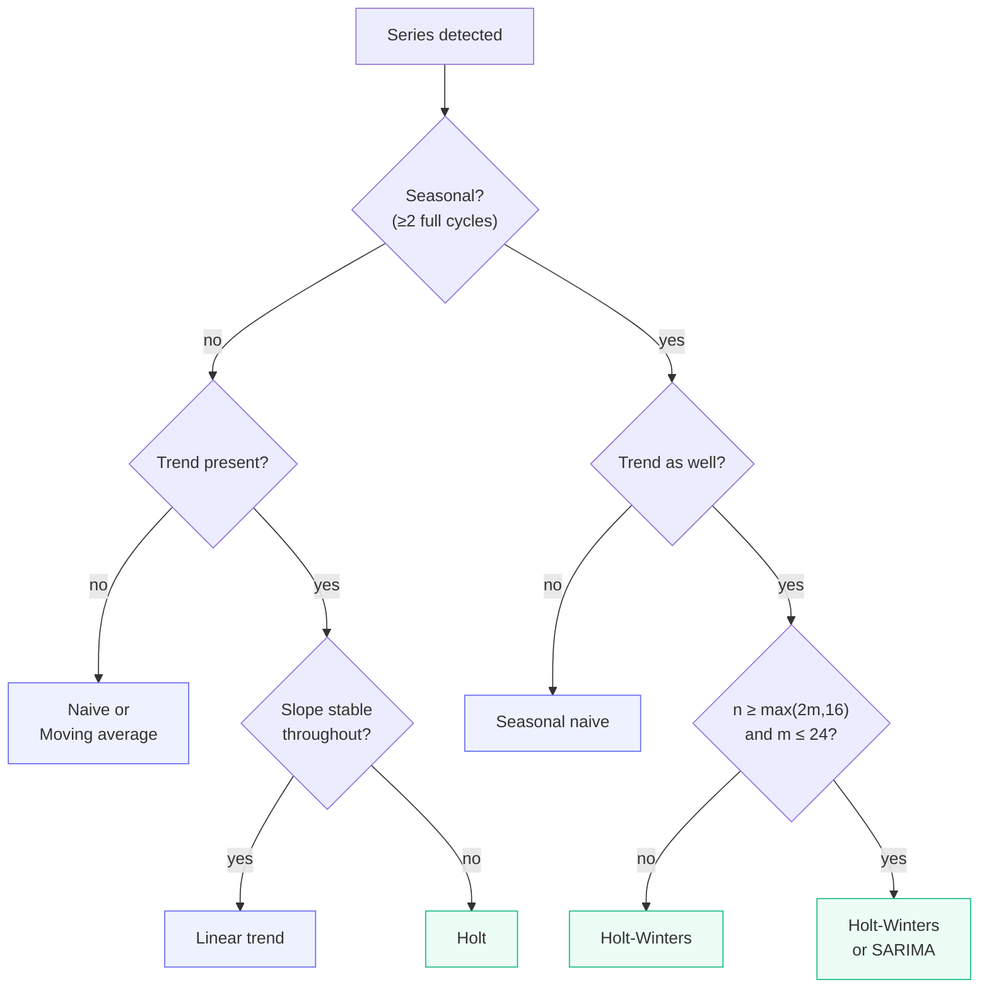

# Report 2 — Method Reference

**AI-Powered Conversational Analytics Platform**
Technical report series on the predictive-analytics subsystem.

---

## 1. Notation

Throughout, let

- $y_1, \dots, y_n$ &nbsp; be the observed series (`TimeSeriesProfile.y`), ordered ascending;
- $n$ &nbsp; the number of periods (`n_points`);
- $h = 1, \dots, H$ &nbsp; the forecast step, $H$ the horizon;
- $m$ &nbsp; the seasonal period (`seasonal_period`), where defined;
- $\hat{y}_{n+h}$ &nbsp; the point forecast $h$ steps ahead;
- $z$ &nbsp; the standard-normal quantile for the requested confidence (§2);
- $\hat{\sigma}$ &nbsp; an estimate of the one-step error standard deviation.

Implementations live in `app/core/forecasting.py`, dispatched through
`_REGISTRY`. Each returns the five-tuple
`(yhat, lower, upper, fitted, warnings)`.

---

## 2. Confidence bands: the common machinery

### 2.1 Quantiles without SciPy

Interval half-widths use hard-coded normal quantiles rather than a SciPy
dependency:

$$z \in \{1.2816,\ 1.6449,\ 1.9600,\ 2.5758\} \quad\text{for}\quad
1-\alpha \in \{0.80,\ 0.90,\ 0.95,\ 0.99\}$$

`_z(confidence)` returns the exact entry when present and otherwise the nearest
available level. A request for 85% therefore silently yields the 80% quantile.
This is a deliberate trade — one fewer heavyweight dependency in a desktop
application that ships as a PyInstaller bundle — and the UI only ever offers
80/90/95, so the approximation is unreachable through normal use.

### 2.2 Band growth with horizon

Three growth regimes appear, and the distinction is substantive:

| Regime | Half-width at step $h$ | Used by |
|---|---|---|
| Random-walk | $z\hat{\sigma}\sqrt{h}$ | `naive` |
| Seasonal random-walk | $z\hat{\sigma}\sqrt{\lceil h/m \rceil}$ | `seasonal_naive` |
| Constant | $z\hat{\sigma}$ | `moving_average` |
| Regression | $z \cdot s \sqrt{1 + \tfrac{1}{n} + \tfrac{(x_f-\bar{x})^2}{S_{xx}}}$ | `linear_trend` |
| Residual $\sqrt{h}$ | $z\hat{\sigma}\sqrt{h}$ | `holt`, `holt_winters` |
| Model-derived | from the state-space covariance | `sarima` |

The $\sqrt{h}$ growth is the exact variance accumulation for a random walk: if
$y_t = y_{t-1} + \varepsilon_t$ with $\mathrm{Var}(\varepsilon)=\sigma^2$, then
$\mathrm{Var}(y_{n+h} \mid y_n) = h\sigma^2$.

Applying the same $\sqrt{h}$ rule to Holt and Holt-Winters (`_resid_band`) is an
**approximation**, not the exact prediction variance for those models. The true
expression for Holt's linear trend involves the smoothing parameters:

$$\mathrm{Var}(y_{n+h}) = \sigma^2\left[1 + \sum_{j=1}^{h-1}(\alpha + j\alpha\beta^*)^2\right]$$

The implemented approximation is generally *narrower* than the exact interval
for trended series. Intervals from these two methods should be read as
indicative rather than exact. SARIMA, which obtains intervals from the fitted
state-space model, does not share this caveat.

### 2.3 Non-negativity clamping

After band construction, `_compute` applies:

```python
if lower is not None and float(np.min(y)) >= 0:
    lower = [max(0.0, v) for v in lower]
```

If no observed value is negative, the lower bound is clamped at zero. This
prevents the visually absurd "sales of −40,000" on short or volatile series. It
is a presentation-layer correction, not a distributional one: the clamped
interval no longer has exactly the nominal coverage, and is conservative on the
lower side. The alternative — modelling on a log scale — would change the point
forecasts too, and was rejected as too large a behavioural change for the
benefit.

---

## 3. Naive

**Registry key** `naive` · **Implementation** `_naive` · numpy only

### Point forecast

$$\hat{y}_{n+h} = y_n \qquad h = 1,\dots,H$$

### Error estimate and band

Residuals are first differences, $\hat{\sigma} = \mathrm{sd}(\Delta y)$ where
$\Delta y_t = y_t - y_{t-1}$:

$$\hat{y}_{n+h} \pm z\hat{\sigma}\sqrt{h}$$

### Fitted values

$\hat{y}_t = y_{t-1}$, with $\hat{y}_1 = y_1$ to keep the array aligned to
history.

### Assumptions and use

Optimal when the series is a random walk — that is, when changes are
unpredictable from the past. Despite its triviality it is the **correct
baseline**: any method that cannot beat naive on backtest has learned nothing
generalisable from the data. In §5 of [Report 5](05-backtesting.md) it beats
three more elaborate methods on the Walmart weekly series.

Weakness: it discards all information but the final observation, so a single
anomalous last period propagates across the entire horizon.

---

## 4. Seasonal naive

**Registry key** `seasonal_naive` · **Implementation** `_seasonal_naive` · numpy only

### Point forecast

$$\hat{y}_{n+h} = y_{n-m+((h-1) \bmod m)+1}$$

Each future period repeats the corresponding period of the most recent complete
cycle: next January takes last January's value.

### Error estimate and band

Residuals are seasonal differences, $\hat{\sigma} = \mathrm{sd}(y_t - y_{t-m})$.
The band widens once per *cycle* rather than per step:

$$\hat{y}_{n+h} \pm z\hat{\sigma}\sqrt{\lceil h/m \rceil}$$

so all periods within the first cycle share a width. This is correct for a
seasonal random walk, where uncertainty accumulates per cycle.

Where $n \le m$ — insufficient history for a seasonal difference — the code
falls back to $\mathrm{sd}(\Delta y)$.

### Assumptions and use

Assumes a stable seasonal pattern and no trend. Strong on the Walmart series,
where the Thanksgiving and Christmas peaks recur reliably; it placed second
there on MAPE. Systematically biased under a trend, since it carries forward
level from a full cycle ago.

---

## 5. Moving average

**Registry key** `moving_average` · **Implementation** `_moving_average` · numpy only

### Point forecast

With window $w = \max(1, \min(m \text{ or } 3,\ n))$:

$$\hat{y}_{n+h} = \frac{1}{w}\sum_{t=n-w+1}^{n} y_t \qquad \text{for all } h$$

A flat projection at the trailing mean.

### Error estimate and band

Fitted values are the trailing means $\hat{y}_t = \frac{1}{w}\sum_{i=t-w+1}^{t} y_i$
(expanding for $t<w$); $\hat{\sigma} = \mathrm{sd}(y - \hat{y})$; the band is
**constant** in $h$:

$$\hat{y}_{n+h} \pm z\hat{\sigma}$$

### Assumptions and use

Assumes a locally constant level with additive noise. The constant band is
honest for that assumption and misleading when it is violated: a trended series
gets an interval that does not widen even as the point forecast drifts further
from plausibility.

Note the window defaults to the *seasonal period* when one exists. On a monthly
seasonal series this averages a full year, which usefully cancels seasonality
but responds slowly to genuine level change.

---

## 6. Linear trend

**Registry key** `linear_trend` · **Implementation** `_linear_trend` · numpy only

### Point forecast

Ordinary least squares of $y$ on the time index $x_t = t-1$, via `np.polyfit`:

$$\hat{y}(x) = \hat{\beta}_1 x + \hat{\beta}_0, \qquad
\hat{y}_{n+h} = \hat{\beta}_1 (n-1+h) + \hat{\beta}_0$$

### Error estimate and band

This is the only method using a textbook-exact interval. With residual standard
error

$$s = \sqrt{\frac{\sum_{t}(y_t - \hat{y}_t)^2}{n-2}}, \qquad
S_{xx} = \sum_t (x_t - \bar{x})^2$$

the prediction standard error at $x_f = n-1+h$ is

$$\mathrm{se}(x_f) = s\sqrt{1 + \frac{1}{n} + \frac{(x_f - \bar{x})^2}{S_{xx}}}$$

$$\hat{y}_{n+h} \pm z \cdot \mathrm{se}(x_f)$$

The three terms are, in order: irreducible noise, uncertainty in the intercept,
and uncertainty in the slope amplified by distance from the centre of the data.
The band is a hyperbola, narrowest at $\bar{x}$ and widening outward — the
correct qualitative behaviour for extrapolation.

Strictly, $z$ should be a $t_{n-2}$ quantile rather than normal. For $n \ge 30$
the difference is under 4%; for $n = 8$ it is around 20% and the interval is
correspondingly too narrow.

### Assumptions and use

Assumes a deterministic linear trend with homoscedastic independent errors. It
is also the **universal fallback**: `_run_method` defaults to it for unknown
keys, and every failure path degrades to it. It always runs and always produces
a band.

Weakness: extrapolates without bound. Over a long horizon it will happily
project negative or implausibly large values — hence the clamping in §2.3.

---

## 7. Holt's linear trend

**Registry key** `holt` · **Implementation** `_holt` · **requires statsmodels**

### Model

Exponential smoothing with level $\ell_t$ and trend $b_t$:

$$\begin{aligned}
\ell_t &= \alpha y_t + (1-\alpha)(\ell_{t-1} + b_{t-1}) \\
b_t &= \beta^*(\ell_t - \ell_{t-1}) + (1-\beta^*)b_{t-1} \\
\hat{y}_{n+h} &= \ell_n + h\,b_n
\end{aligned}$$

$\alpha, \beta^* \in (0,1)$ are estimated by maximum likelihood
(`initialization_method="estimated"`).

### Band

$\hat{\sigma} = \mathrm{sd}(y - \hat{y}^{\text{fitted}})$, then `_resid_band`
with $\sqrt{h}$ growth — the approximation discussed in §2.2.

### Assumptions and use

Trend, no seasonality. Unlike `linear_trend` it weights recent observations more
heavily, so it adapts to a changing slope. Requires $n \ge 6$.

The distinction from `linear_trend` is worth stating plainly: linear trend fits
one straight line to all history; Holt tracks a *locally* linear trend that may
change. On a series whose growth rate shifted, Holt adapts and linear trend
averages the two regimes into something matching neither.

---

## 8. Holt-Winters

**Registry key** `holt_winters` · **Implementation** `_holt_winters` · **requires statsmodels**

### Model

Additive trend and additive seasonality:

$$\begin{aligned}
\ell_t &= \alpha(y_t - s_{t-m}) + (1-\alpha)(\ell_{t-1}+b_{t-1}) \\
b_t &= \beta^*(\ell_t - \ell_{t-1}) + (1-\beta^*)b_{t-1} \\
s_t &= \gamma(y_t - \ell_{t-1} - b_{t-1}) + (1-\gamma)s_{t-m} \\
\hat{y}_{n+h} &= \ell_n + h\,b_n + s_{n-m+((h-1)\bmod m)+1}
\end{aligned}$$

Configured `trend="add", seasonal="add"`, with `seasonal_periods = m` (falling
back to 2 if undefined).

### Band

As Holt: residual standard deviation with $\sqrt{h}$ growth.

### Assumptions and use

Trend **and** stable seasonality, with seasonal amplitude roughly constant in
absolute terms. Requires two complete cycles. The best performer on the Walmart
weekly series (MAPE 0.6%), which has both a mild trend and a pronounced 52-week
cycle.

The additive-only configuration is a limitation: where seasonal swings scale
with the level — common in revenue that has grown severalfold — a multiplicative
formulation would fit better. The code does not offer one.

---

## 9. SARIMA

**Registry key** `sarima` · **Implementation** `_sarima` · **requires statsmodels**

### Model

$\text{SARIMA}(1,1,1)\times(1,1,0)_m$, fixed orders:

$$(1-\phi_1 B)(1-\Phi_1 B^m)(1-B)(1-B^m) y_t = (1+\theta_1 B)\varepsilon_t$$

where $B$ is the backshift operator. Non-seasonal part: one AR term, one degree
of differencing, one MA term. Seasonal part: one seasonal AR term and one
seasonal difference. Where $m$ is undefined or $n < 2m$, the seasonal order
collapses to $(0,0,0,0)$ and the model reduces to ARIMA(1,1,1).

`enforce_stationarity=False` and `enforce_invertibility=False` are set so that
fitting does not fail outright on borderline series; the cost is that estimated
parameters may lie outside the stationary region, and such fits should be
treated with suspicion.

### Band

Unlike every other method here, intervals come from the fitted model:
`get_forecast(H).conf_int(alpha=1-confidence)`. These are proper model-based
prediction intervals accounting for parameter and innovation uncertainty — the
most statistically defensible bands the application produces.

### Assumptions and use

The most flexible method, and the most demanding. Requires
$n \ge \max(2m, 16)$ and $m \le 24$; the latter excludes it from weekly data
($m = 52$), where a $(1,1,0)_{52}$ seasonal term would need hundreds of
observations to estimate.

**The orders are fixed, not selected.** There is no `auto.arima`-style search
over $(p,d,q)\times(P,D,Q)$. $(1,1,1)\times(1,1,0)_m$ is a reasonable
general-purpose default, but a genuinely ARIMA-appropriate series will usually
be fitted better by a searched specification. This is the largest gap between
the implementation and standard practice.

---

## 10. Auto

**Registry key** `auto` — a *strategy*, not a method. See `_auto_select`.

Not present in `_REGISTRY`: `_compute` resolves it before dispatch by
backtesting every eligible candidate and keeping the lowest MAPE. Full treatment
in [Report 5](05-backtesting.md) §4.

Two consequences worth noting here:

- `ForecastResult.method` never holds `"auto"` — it holds the resolved method.
  This is what is persisted, so replay reproduces the model actually used.
- The selection is recorded as a warning, e.g.
  `"auto-selected holt_winters (backtest MAPE 0.6%)"`, and surfaced in the UI
  badge.

---

## 11. Comparison

| Method | Trend | Season | Min $n$ | Band growth | Dependency |
|---|:---:|:---:|:---:|---|---|
| Naive | — | — | 2 | $\sqrt{h}$ | numpy |
| Seasonal naive | — | ✓ | $2m$ | $\sqrt{\lceil h/m \rceil}$ | numpy |
| Moving average | — | — | 1 | constant | numpy |
| Linear trend | ✓ (global) | — | 2 | hyperbolic (exact) | numpy |
| Holt | ✓ (local) | — | 6 | $\sqrt{h}$ (approx) | statsmodels |
| Holt-Winters | ✓ (local) | ✓ | $2m$ | $\sqrt{h}$ (approx) | statsmodels |
| SARIMA | ✓ | ✓ | $\max(2m,16)$, $m \le 24$ | model-derived | statsmodels |

### Selection guidance



In practice **Auto** implements this decision empirically rather than by rule,
and is the default. The tree is offered for readers who wish to reason about
*why* a given method won.

---

## 12. Implementation notes

### 12.1 Uniform signature

Every method is `fn(y, horizon, period, z, confidence) -> MethodResult`, so
`_REGISTRY` dispatch requires no special-casing and a new method needs only an
entry in the registry plus availability rules.

### 12.2 Fitted values

Each method returns an in-sample fit aligned to history, used by the chart to
draw a continuous line from history into projection. The naive methods pad the
first $m$ (or one) entries with observed values to preserve alignment; those
padded entries are not genuine fits and should not be read as such.

### 12.3 Failure handling

```python
try:
    yhat, lower, upper, fitted, mwarn = _run_method(chosen, ...)
except Exception as exc:
    warnings.append(f"{chosen} failed ({type(exc).__name__}); fell back to linear_trend.")
    chosen = "linear_trend"
    yhat, lower, upper, fitted, _ = _linear_trend(...)
```

Statsmodels raises on singular or degenerate fits (constant series, too few
points after differencing). Rather than surfacing a stack trace, the engine
falls back and records the substitution in `warnings`, which reaches the UI
badge and the narrative.

---

## Report series

| # | Report |
|---|---|
| 1 | [Forecasting Architecture](01-architecture.md) |
| 2 | **Method Reference** — this document |
| 3 | [The Relevance Gate](03-relevance-gate.md) |
| 4 | [Parameter Selection](04-parameter-selection.md) |
| 5 | [Backtesting and Accuracy](05-backtesting.md) |

### References

Hyndman, R.J. & Athanasopoulos, G. (2021). *Forecasting: Principles and
Practice*, 3rd ed. OTexts. — Chapters 3 (benchmarks), 8 (exponential smoothing),
9 (ARIMA).

Box, G.E.P., Jenkins, G.M., Reinsel, G.C. & Ljung, G.M. (2015). *Time Series
Analysis: Forecasting and Control*, 5th ed. Wiley.

Hyndman, R.J. & Koehler, A.B. (2006). Another look at measures of forecast
accuracy. *International Journal of Forecasting*, 22(4), 679–688.
