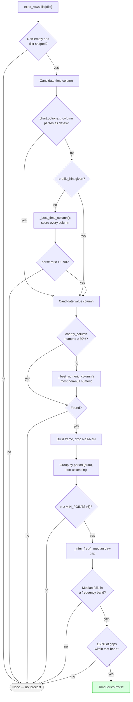
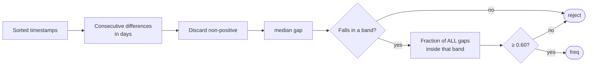

# Report 3 — The Relevance Gate

**AI-Powered Conversational Analytics Platform**
Technical report series on the predictive-analytics subsystem.

---

## 1. The problem

A conversational analytics tool receives questions of every shape. "Sales by
region", "top 10 products", "how many orders last month", "monthly revenue" —
only the last is a time series. Offering a forecast on the others would be
worse than useless: it would attach a projection to a categorical axis, implying
a temporal ordering that does not exist.

The gate is the mechanism that decides. It is implemented in
`app/core/timeseries.py` as `detect_time_series()`, which returns a
`TimeSeriesProfile` or `None`. **`None` means the entire predictive layer is
skipped** — no chart overlay, no controls, no narrative.

The design commitment is that the gate should be **conservative**: a false
negative costs a missing forecast on a valid series, which the user can work
around by rephrasing. A false positive attaches a confident projection to
meaningless data, which the user may believe.

---

## 2. The decision procedure



Every branch to `None` is a *rejection*, and each has a distinct explanation in
`explain_not_forecastable()` (§7).

---

## 3. Column selection

### 3.1 Time column

Three sources are tried in order:

1. **`chart.options.x_column`** — the analyst LLM's stated x-axis. Accepted only
   if the column exists *and* parses as dates above threshold. The model's
   suggestion is a hint, never trusted on its own.
2. **`profile_hint`** — an explicit caller override, used in testing.
3. **`_best_time_column()`** — scoring across all columns.

The scoring function is:

$$\text{score}(c) = \rho(c) + 0.05 \cdot \mathbb{1}[\text{name hints at time}]$$

where $\rho(c)$ is the fraction of values in column $c$ that parse as dates, and
the name hints are

```
date, day, month, year, period, time, week, quarter, dt
```

The 0.05 nudge only breaks ties between columns with near-equal parse ratios; it
cannot promote a column that does not parse. A column named `order_date` holding
free text will still be rejected.

The winner must then independently satisfy

$$\rho(c) \ge \texttt{PARSE\_THRESHOLD} = 0.90$$

### 3.2 Why 90% rather than 100%

Real query results contain nulls and occasional malformed values. Demanding
perfect parsing would reject otherwise sound series over a single bad row.
Demanding much less would admit columns that merely *resemble* dates — a free
text field where a tenth of entries happen to be parseable.

At 90%, a 143-week series tolerates 14 unparseable periods. Non-parsing rows are
dropped rather than imputed, so tolerance and data loss trade off directly.

### 3.3 Value column

Accepted if at least 80% of entries are numeric (`_is_numeric_col`). Where the
analyst's `y_column` fails, `_best_numeric_column()` selects the column with the
most non-null numeric values, excluding the time column.

The lower threshold reflects that numeric columns are more often sparse — a
measure legitimately null for some periods is common, whereas a date column with
10% junk suggests it is not really a date column.

---

## 4. Temporal parsing

`_parse_time()` handles three cases before falling back to general parsing:

### 4.1 Bare years

If every value is an integer in $[1900, 2100]$, values are read as annual
periods (`2019` → `2019-01-01`) and the frequency hint `Y` is returned directly.

This exists because a year column is numerically indistinguishable from a
measure. Without the special case, `2019, 2020, 2021` would be parsed as
nanosecond epochs or rejected.

### 4.2 Quarter strings

The regular expression

```
^\s*(?:(\d{4})[-/\s]*q([1-4])|q([1-4])[-/\s]*(\d{4}))\s*$
```

matches both `2024-Q3` and `Q3 2024`, case-insensitively, mapping to the first
day of the quarter. Hint `Q` is returned.

### 4.3 General parsing

Everything else goes to `pd.to_datetime(errors="coerce")`, with the mixed-format
`UserWarning` suppressed — heterogeneous date strings are expected here, and
falling back to `dateutil` per element is the intended behaviour.

---

## 5. Frequency inference

### 5.1 Procedure



### 5.2 The bands

| Frequency | Lower (days) | Upper (days) | Nominal | Seasonal period $m$ |
|---|---:|---:|---:|---:|
| `D` daily | 0.5 | 2.0 | 1 | 7 |
| `W` weekly | 5.0 | 9.0 | 7 | 52 |
| `M` monthly | 26.0 | 32.0 | 30.4 | 12 |
| `Q` quarterly | 84.0 | 96.0 | 91.3 | 4 |
| `Y` yearly | 350.0 | 380.0 | 365.25 | — |

Bands are asymmetric and deliberately generous. Calendar months range from 28 to
31 days, so a strict interval around 30.4 would misclassify February. The
monthly band spans 26–32 to absorb this. Gaps between 2 and 5 days, or 9 and 26,
match nothing and cause rejection — there is no "every 3 days" frequency.

`Y` has no seasonal period: annual data cannot exhibit within-year seasonality
by construction.

### 5.3 The regularity criterion

Median classification alone is insufficient. A series of mostly-monthly gaps
with several multi-year jumps would have a monthly median while not being a
regular monthly series. So after classification:

$$\frac{|\{d_i : \text{lo} \le d_i \le \text{hi}\}|}{|\{d_i\}|} \ge
\texttt{\_REGULARITY} = 0.60$$

At 60%, up to 40% of intervals may be irregular. This is lenient — deliberately
so, because real business data has gaps: closed periods, missing weeks,
partially loaded data. The tolerance admits series with genuine holes rather
than rejecting them outright.

The residual risk is that a badly gapped series passes and is then forecast as
though evenly spaced, since no imputation occurs. Missing periods are simply
absent from `y`, so a monthly series missing three months is modelled as though
those months never existed. This is [limitation 4 in Report 1](01-architecture.md#10-known-limitations).

---

## 6. Aggregation and seasonality

### 6.1 One value per period

```python
frame = frame.groupby("t", as_index=False)["y"].sum().sort_values("t")
```

Rows sharing a timestamp are **summed**, not averaged. This suits the dominant
case — SQL returning transaction-level rows that should total per period. It is
wrong for intensive measures such as average price or temperature, where summing
duplicates is meaningless. The planner is instructed to aggregate in SQL, so
duplicates should be rare, but the behaviour is worth knowing.

### 6.2 Minimum length

$$n \ge \texttt{MIN\_POINTS} = 6$$

Six is the smallest count permitting a meaningful holdout: the default holdout
is $\min(6, \max(1, \lfloor n/4 \rfloor), m)$, capped at $n-2$, so at $n=6$ a
holdout of 1–4 still leaves points to fit on. Below six, no method can be
scored, so no method can be justified.

### 6.3 Seasonality determination

$$\texttt{is\_seasonal} = (m \ne \text{None}) \wedge (n \ge 2m)$$

Two complete cycles is the minimum for estimating a seasonal pattern at all: one
cycle cannot distinguish seasonality from trend or noise. Note the criterion is
purely structural — no statistical test for seasonal significance is performed.
A 24-month series is declared seasonal whether or not a real annual pattern
exists. The consequence is that seasonal methods are *offered*; whether they are
*chosen* is settled empirically by backtest.

---

## 7. Explaining rejection

When the planner set `forecast_requested`, silence would read as the application
ignoring the user. `explain_not_forecastable()` re-walks the same checks and
reports the first failure in the user's terms.

| Failure | Message |
|---|---|
| No rows | "The query returned no rows, so there is nothing to project." |
| No date column | "This result has no date or period column… Columns returned: *…*" |
| Below parse threshold | "The column '*x*' could not be read as dates — only *n*% of its values parsed…" |
| No numeric measure | "No numeric measure was returned alongside the dates…" |
| Too few periods | "Only *n* distinct periods came back, and at least 6 are needed…" |
| Irregular spacing | "The periods are spaced too irregularly… Grouping with DATE_TRUNC usually fixes this." |

Two properties are enforced by test: each message names the *specific*
obstruction — the actual column list, the actual period count — and each
suggests a remedy. `test_explanation_is_always_a_usable_sentence` asserts every
path returns a capitalised, full-stopped sentence for arbitrary input.

The function duplicates the detection logic rather than instrumenting it. This
is a conscious trade: `detect_time_series` stays a clean predicate returning
`Optional`, at the cost of the two walking the same checks. They must be kept in
step, and the shared constants (`MIN_POINTS`, `PARSE_THRESHOLD`) reduce the
surface where they could diverge.

---

## 8. Worked example — Walmart weekly sales

From the shipped `input_data/walmart_sales.csv`, aggregated weekly:

| Stage | Outcome |
|---|---|
| Time column | `sale_week` — 100% parse, name hint matched |
| Value column | `total_sales` — 100% numeric |
| Rows after cleaning | 143 |
| Median gap | 7.0 days |
| Band matched | `W` (5.0–9.0) |
| Regularity | 100% of gaps in band |
| $n \ge 6$ | Yes (143) |
| $m$ | 52 |
| $n \ge 2m$ | $143 \ge 104$ → seasonal |
| Range | 2010-02-05 → 2012-10-26 |

Result: profile accepted, all seven methods eligible except SARIMA, which is
withheld because $m = 52 > 24$ (see [Report 4](04-parameter-selection.md) §3).

---

## 9. Summary of constants

| Constant | Value | Location | Governs |
|---|---:|---|---|
| `MIN_POINTS` | 6 | `timeseries.py` | Minimum periods |
| `PARSE_THRESHOLD` | 0.90 | `timeseries.py` | Date-parse fraction |
| `_REGULARITY` | 0.60 | `timeseries.py` | Gap-conformity fraction |
| numeric threshold | 0.80 | `_is_numeric_col` | Measure numeric fraction |
| name-hint bonus | 0.05 | `_best_time_column` | Tie-break weight |
| seasonal minimum | $2m$ | `detect_time_series` | Seasonality flag |

All are module-level and unconfigurable at runtime. They were chosen against the
bundled retail datasets and have not been tuned against a broader corpus —
a fair criticism of the current implementation, and the obvious avenue for
future work.

---

## Report series

| # | Report |
|---|---|
| 1 | [Forecasting Architecture](01-architecture.md) |
| 2 | [Method Reference](02-method-reference.md) |
| 3 | **The Relevance Gate** — this document |
| 4 | [Parameter Selection](04-parameter-selection.md) |
| 5 | [Backtesting and Accuracy](05-backtesting.md) |
