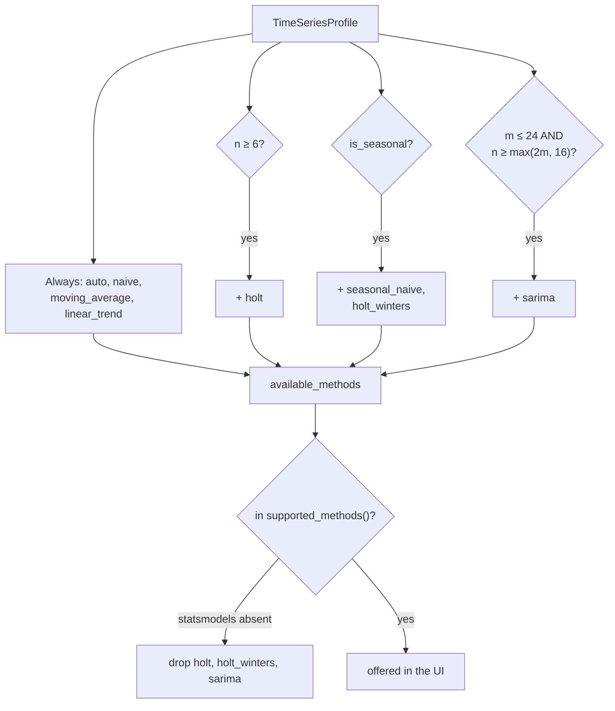
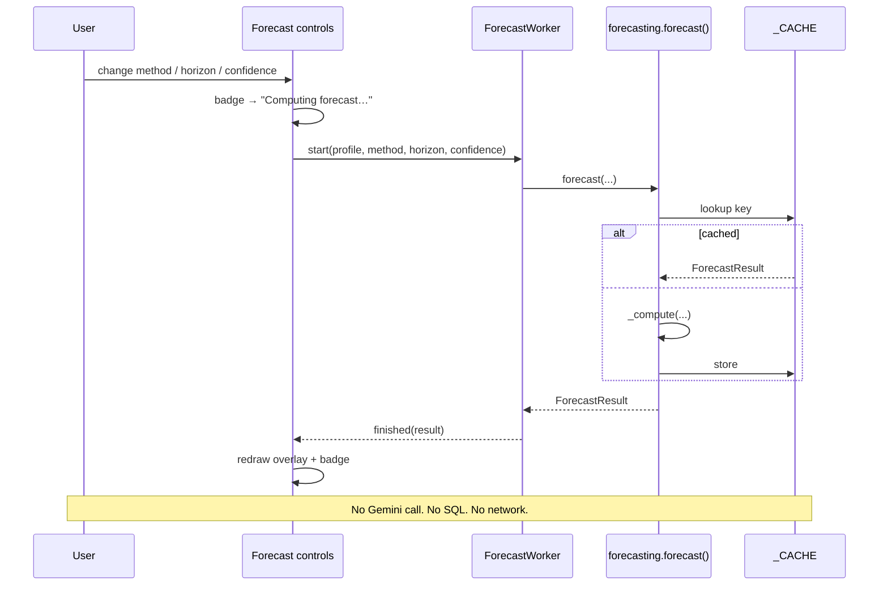

# Report 4 — Parameter Selection

**AI-Powered Conversational Analytics Platform**
Technical report series on the predictive-analytics subsystem.

---

## 1. The three parameters

A forecast is determined by exactly three user-facing parameters plus the
detected series:

| Parameter | Type | Default | Range | Effect |
|---|---|---|---|---|
| **Method** | enumerated | `auto` | eligible methods only | Which model generates the projection |
| **Horizon** | integer | 12 | 1–36 (`FORECAST_MAX_HORIZON`) | How many periods ahead |
| **Confidence** | float | 0.80 | 0.80 / 0.90 / 0.95 | Width of the interval |

Defaults are configurable in **Settings → Forecasting** and persisted in
`Settings.forecast_default_method`, `forecast_default_horizon`,
`forecast_confidence`, `forecast_enabled_by_default`.

The design principle governing all three: **the user may only choose options
that are valid for their data.** Rather than accepting a request and failing, or
silently substituting, the interface offers only what the series supports and
explains what it withholds.

---

## 2. Method eligibility

### 2.1 The rules

`available_methods(profile)` derives the offered list from the profile alone:

| Method | Condition | Justification |
|---|---|---|
| `auto`, `naive`, `moving_average`, `linear_trend` | always | Need no structure beyond two points |
| `holt` | $n \ge 6$ | Two smoothing parameters plus initial level and trend |
| `seasonal_naive`, `holt_winters` | `is_seasonal` ($n \ge 2m$) | A seasonal index needs two cycles to estimate |
| `sarima` | $m \le 24$ and $n \ge \max(2m, 16)$ | See §2.2 |

### 2.2 Why SARIMA is excluded from weekly data

The $m \le 24$ ceiling is the most consequential eligibility rule, because it
excludes SARIMA from every weekly series ($m = 52$).

A $(1,1,0)_{52}$ seasonal component requires estimating a parameter that relates
each observation to the one 52 periods earlier. Reliable estimation needs many
complete cycles — several years of weekly data — and the state-space fit costs
grow steeply with seasonal order. On the 143-week Walmart series, fitting would
be both slow and poorly identified: barely three cycles for a parameter that
needs far more.

The rule is a pragmatic ceiling, not a theoretical bound. A user with ten years
of weekly data would benefit from SARIMA and cannot have it. This is a known
conservatism, documented rather than hidden.

### 2.3 Availability is explained, not merely enforced

`method_availability(profile)` returns *every* known method with a reason, so
the panel can show why a method is missing:

| Situation | Message |
|---|---|
| Offered | "Available." |
| statsmodels absent | "Needs statsmodels, which is not installed." |
| `holt`, $n<6$ | "Needs at least 6 periods; this series has *n*." |
| Seasonal methods, not seasonal | "Needs a full seasonal cycle. At *F* frequency that is *m* periods twice over; this series has *n*." |
| `sarima`, $m>24$ | "Seasonal period of *m* is too long to fit reliably." |
| `sarima`, too short | "Needs at least *max(2m,16)* periods; this series has *n*." |

This turns a shrinking dropdown from something arbitrary into something
informative: the user learns what their data would need to support the method.

---

## 3. Horizon

### 3.1 Units

Horizon is measured in **periods of the detected frequency**, not fixed
calendar units. A horizon of 12 means twelve weeks on weekly data and twelve
months on monthly data. The control makes this explicit through a suffix drawn
from `PERIOD_NOUN`, so the spin box reads `12 weeks` rather than `12`.

Future period labels come from `future_labels()`, which advances the last
observed timestamp by the frequency and formats to match the historical labels —
so a monthly series continues `2025-06, 2025-07, …` and a quarterly one
continues `2025-Q2, 2025-Q3, …`.

### 3.2 The cap

$$H \le \texttt{FORECAST\_MAX\_HORIZON} = 36$$

Enforced in `_compute` via `max(1, min(horizon, 36))`, so an out-of-range
request is clamped rather than rejected.

The cap is a statement about credibility rather than computation. Thirty-six
periods is three years monthly, nine months weekly, nine years quarterly. Beyond
that, extrapolation from a purely historical model is not defensible for any
method here, none of which incorporate external information.

### 3.3 Relationship to series length

There is **no rule tying horizon to $n$**. A user may request 36 periods from a
6-point series. The forecast will compute, and the interval will be wide, but
nothing prevents it.

A common heuristic caps the horizon at $n/3$ or similar. It is not implemented.
The partial defence is that the narrative reports interval width relative to the
projected value, so an absurd extrapolation announces itself:

> By 2028-06 the 90% interval spans 12,400 to 918,300 — about 730% of the
> projected value.

A reader who ignores that has been told.

---

## 4. Confidence

### 4.1 Semantics

The confidence level sets the nominal coverage of the shaded band: a 90% band is
constructed so that the actual value falls inside it 9 times in 10, *if the
model's assumptions hold*.

The tooltip states this carefully — "wider means less precise, not more
certain" — because the intuitive reading is backwards. Raising confidence from
80% to 95% does not make the forecast better; it makes the band wider to admit
more of the uncertainty that was always present.

### 4.2 Available levels

Only 80%, 90% and 95% are offered, matching the exact entries in the `_Z` table
(§2.1 of [Report 2](02-method-reference.md)). The 99% quantile exists in the
table but is not exposed; at that level bands on short series become so wide as
to convey nothing.

`_z()` falls back to the nearest available quantile for any other value, so a
programmatic caller requesting 0.85 receives the 0.80 band. Reachable only
through the API, not the UI.

### 4.3 Interaction with method

Confidence affects only band width for six of seven methods — the point forecast
is unchanged. **SARIMA is the exception**: `conf_int(alpha=1-confidence)` derives
intervals from the fitted state-space model, so changing confidence there
re-derives from the model rather than rescaling a residual estimate.

Confidence also enters `backtest()` and therefore auto-selection, but only as a
pass-through to the method; MAPE compares point forecasts, so the selected
method is in practice invariant to confidence.

---

## 5. Interaction and recomputation

Three properties follow:

- **Free.** No tokens, no query. A user may explore every method at no cost.
- **Fast.** Repeated settings hit `_CACHE`; toggling back and forth is instant.
- **Available offline.** Recomputation works after the database connection has
  been dropped, and on a replayed historical analysis.

The third point is why the persistence layer stores the `TimeSeriesProfile`
alongside the result: without it the controls would be dead on a replayed item.

---

## 6. Defaults

| Setting | Default | Reasoning |
|---|---|---|
| `forecast_enabled_by_default` | `True` | Forecasts are relevance-gated, so enabling costs nothing on non-series results |
| `forecast_default_method` | `auto` | Empirical selection beats a fixed guess across unknown datasets |
| `forecast_default_horizon` | 12 | One year monthly, one quarter weekly — a natural planning window |
| `forecast_confidence` | 0.80 | Narrower band, more readable chart; the honest 90/95 alternatives crowd the plot on volatile series |

The 80% default deserves scrutiny. It is the least conservative offered, chosen
for legibility. A reader who wants the conventional 95% must select it. The
counter-argument — that a default should be conservative because most users
never change defaults — is reasonable, and this is a defensible point of
disagreement rather than a settled question.

---

## 7. What cannot be configured

Documented so the boundary is explicit:

| Fixed | Value | Where |
|---|---|---|
| Detection thresholds | `MIN_POINTS`, `PARSE_THRESHOLD`, `_REGULARITY` | `timeseries.py` module constants |
| Frequency bands | 5 bands, fixed day ranges | `_FREQ_BANDS` |
| Seasonal periods | D→7, W→52, M→12, Q→4 | `_SEASONAL_PERIOD` |
| SARIMA orders | $(1,1,1)\times(1,1,0)_m$ | `_sarima` |
| Moving-average window | $m$ or 3 | `_moving_average` |
| Backtest holdout | $\min(6, \lfloor n/4 \rfloor, m)$ | `backtest()` |
| Auto-selection criterion | lowest MAPE | `_auto_select` |
| Cache size | 128 entries | `forecast()` |

None are exposed in Settings. The reasoning is that they are modelling decisions
rather than preferences: a user well-informed enough to tune the regularity
threshold is better served editing the source. The counter-view is that fixed
SARIMA orders in particular are a significant limitation for anyone with
genuinely ARIMA-appropriate data.

---

## 8. Parameter effects at a glance

| Change | Point forecast | Band | Method | Cost |
|---|---|---|---|---|
| Method | changes | changes | — | one fit |
| Horizon ↑ | extends | widens (most methods) | unchanged | one fit |
| Confidence ↑ | unchanged¹ | widens | unchanged | one fit |
| More history | changes | usually narrows | may change under `auto` | new query |

¹ Except SARIMA, where intervals are model-derived (§4.3).

---

## Report series

| # | Report |
|---|---|
| 1 | [Forecasting Architecture](01-architecture.md) |
| 2 | [Method Reference](02-method-reference.md) |
| 3 | [The Relevance Gate](03-relevance-gate.md) |
| 4 | **Parameter Selection** — this document |
| 5 | [Backtesting and Accuracy](05-backtesting.md) |
