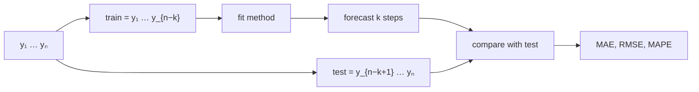
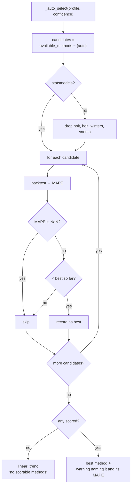

# Report 5 — Backtesting and Accuracy

**AI-Powered Conversational Analytics Platform**
Technical report series on the predictive-analytics subsystem.

---

## 1. Purpose

Every forecast the application displays carries an accuracy figure, and the
default method is chosen by comparing those figures. This report defines how
they are computed, what they do and do not establish, and where the procedure
departs from best practice.

The governing principle is that a forecast without an error estimate is an
assertion. The application refuses to present one: `_compute` always calls
`backtest()` before returning, and the narrative states the result in words —
"strong", "reasonable", "weak", "poor" — so that a number the reader may not
know how to interpret is at least characterised.

---

## 2. Procedure

### 2.1 Holdout construction

The holdout size is

$$k = \min\!\left(6,\ \max(1, \lfloor n/4 \rfloor),\ m \text{ or } 6\right),
\qquad k \leftarrow \min(k,\ n-2)$$

Each term serves a purpose:

| Term | Effect |
|---|---|
| $6$ | Absolute ceiling — a longer holdout starves the fit |
| $\lfloor n/4 \rfloor$ | At most a quarter of history withheld |
| $m$ | Never more than one seasonal cycle |
| $n-2$ | Always leaves at least two points to fit on |

For the 143-week Walmart series: $\min(6, 35, 52) = 6$, so six weeks are held
out and 137 used for fitting. For a 12-month series: $\min(6, 3, 12) = 3$.

Where $k < 1$ the metrics are NaN — the series is too short to score at all,
which the narrative reports explicitly ("too short to score a backtest, so treat
the projection as indicative only").

### 2.2 Scoring

The method is fitted on `train` and asked for exactly $k$ steps, which are
compared against `test`. With $e_i = y_i - \hat{y}_i$ over the holdout:

$$\mathrm{MAE} = \frac{1}{k}\sum_{i=1}^{k}|e_i|$$

$$\mathrm{RMSE} = \sqrt{\frac{1}{k}\sum_{i=1}^{k} e_i^2}$$

$$\mathrm{MAPE} = \frac{100}{k}\sum_{i=1}^{k}\left|\frac{e_i}{y_i}\right|$$

MAPE uses `np.nanmean` over a denominator where $|y_i| < 10^{-9}$ has been
replaced by NaN, so zero-valued periods are excluded rather than producing
infinities. If every holdout value is zero, MAPE is NaN and the method is
unscorable.

Failures during fitting return NaN metrics rather than propagating — a method
that cannot be fitted simply cannot be scored, and sorts last.

---

## 3. Interpreting the three metrics

Each answers a different question, which is why all three are shown.

| Metric | Units | Answers | Sensitive to |
|---|---|---|---|
| **MAE** | measure's own | "How far off on average?" | all errors equally |
| **RMSE** | measure's own | "How far off, weighting big misses?" | outliers, quadratically |
| **MAPE** | percent | "How far off relative to size?" | small denominators |

### 3.1 Why MAPE drives selection

MAPE is scale-free, so it is comparable across series with different magnitudes
and gives a threshold vocabulary that transfers between datasets. The narrative
uses fixed bands:

| MAPE | Description |
|---|---|
| < 10% | strong |
| < 20% | reasonable |
| < 50% | weak |
| ≥ 50% | poor |

These are conventional rules of thumb, not derived from theory, and they are
generous for a series as regular as weekly retail sales while harsh for volatile
data.

### 3.2 MAPE's known defects

Documented because the application relies on it:

1. **Asymmetry.** MAPE penalises over-forecasting more than under-forecasting.
   Predicting 150 when the truth is 100 scores 50%; predicting 50 scores 50% too,
   but predicting 0 scores 100% while there is no over-forecast that can exceed
   100% by the same margin. Selection is therefore mildly biased toward methods
   that under-predict.
2. **Undefined at zero.** Handled by exclusion, which means a series with
   frequent zeros is scored on a subset of its holdout.
3. **Unstable for small values.** Near-zero actuals inflate the ratio, so a
   sparse series can produce a large MAPE despite small absolute errors.

Hyndman & Koehler (2006) recommend MASE — mean absolute scaled error — which is
scale-free, defined at zero, and symmetric. It would be the better criterion and
is **not implemented**. This is the clearest single improvement available to the
evaluation layer.

### 3.3 Reading MAE against RMSE

Because RMSE squares errors before averaging, $\mathrm{RMSE} \ge \mathrm{MAE}$
always, and the ratio is diagnostic. A ratio near 1 means errors are uniform;
a large ratio means a few periods are badly missed while most are close.

From the Walmart comparison (§5): Holt-Winters has RMSE/MAE = 1.20, seasonal
naive 1.38. Seasonal naive's average error is only 12% worse, but it takes
noticeably larger individual misses — presumably in the holiday weeks, where
carrying forward last year's value cannot absorb a shift in timing.

---

## 4. Automatic selection

### 4.1 Procedure

The winner is refitted on **full history** — including the holdout — before
producing the displayed forecast. Backtesting selects the method; it does not
produce the projection.

### 4.2 Transparency

`compare_methods()` runs the same backtest across every eligible method and
returns the full table shown in the "Model details" panel. The invariant that
makes the panel trustworthy is asserted in
`tests/test_forecast_narrative.py::test_comparison_picks_the_same_winner_as_auto`:

> the top scored row of the comparison table must equal `auto`'s resolved method

Without that test, the table could quietly disagree with the selection and no
one would notice. Unscorable methods sort last with `—` rather than being
hidden, so the user sees that a method exists and could not be evaluated.

### 4.3 Limitations of the selection procedure

1. **Single holdout, not cross-validated.** One split of at most six periods.
   Rolling-origin evaluation would be far more robust; it is not implemented,
   principally because it multiplies fitting cost by the number of origins and
   the panel is redrawn interactively.
2. **Selection on the same data that is scored.** The reported MAPE for the
   winning method is optimistically biased, because that method was chosen *for*
   having the lowest value on this holdout. With seven candidates the winner's
   error is a minimum of seven draws, not an unbiased estimate. The displayed
   figure should be read as "best observed" rather than "expected".
3. **Recency-weighted by construction.** The holdout is always the tail, so
   selection favours methods that suit the most recent six periods. For a
   seasonal series this may be an unrepresentative window.
4. **No parsimony penalty.** Ties go to whichever method was evaluated first;
   there is no preference for the simpler model.

Limitation 2 is the one worth stating to any reader of the output. The mitigation
in place is that the comparison table shows *all* methods, so a reader can see
whether the winner led by a wide margin or edged out a rival.

---

## 5. Worked example — Walmart weekly sales

Series as characterised in [Report 3](03-relevance-gate.md) §8: 143 weekly
periods, 2010-02-05 to 2012-10-26, seasonal with $m = 52$, observed range
31,027,057 to 51,828,493. Holdout $k = 6$.

| Rank | Method | MAPE | MAE | RMSE | RMSE/MAE |
|---:|---|---:|---:|---:|---:|
| 1 | **Holt-Winters (seasonal)** | **0.6%** | **209,827** | **252,131** | 1.20 |
| 2 | Seasonal naive | 0.7% | 234,364 | 322,803 | 1.38 |
| 3 | Naive | 2.3% | 832,974 | 1,008,110 | 1.21 |
| 4 | Holt (trend) | 3.8% | 1,352,551 | 1,495,454 | 1.11 |
| 5 | Moving average | 5.1% | 1,833,515 | 1,923,153 | 1.05 |
| 6 | Linear trend | 5.5% | 1,975,166 | 2,060,305 | 1.04 |
| — | SARIMA | — | — | — | withheld, $m = 52 > 24$ |

### Observations

**The two seasonal methods dominate.** Both score under 1% while every
non-seasonal method is above 2%. On a series whose defining feature is an annual
retail cycle, this is the expected and reassuring result: the evaluation
procedure identifies the structure that is actually present.

**Naive beats both trend methods.** This is the more instructive finding. Holt
(3.8%) and linear trend (5.5%) are more sophisticated than repeating last week's
value (2.3%), and both do worse. The reason is that week-to-week change in this
series is dominated by seasonality rather than trend; a method that fits a trend
through seasonal oscillation extracts a slope that is largely artefact. This is
precisely why naive is retained as a baseline — a method that cannot beat it has
not learned anything transferable.

**The margin at the top is thin.** Holt-Winters leads seasonal naive by 0.1
percentage points of MAPE. Given limitation 4.3.2 — the winner's score is the
minimum of six draws — that margin should not be read as establishing
Holt-Winters as decisively superior. The RMSE/MAE ratio is the better
discriminator here: Holt-Winters distributes its error more evenly.

**Ordering is stable across metrics.** MAPE, MAE and RMSE rank the six methods
identically, which is not guaranteed and increases confidence in the ranking.
Where they disagree, the disagreement is itself informative.

---

## 6. Presentation to the user

Accuracy reaches the reader through four channels, all from the same
`ForecastResult.metrics`:

| Channel | Content |
|---|---|
| Badge under the chart | `Model: Holt-Winters · backtest MAPE 0.6% · MAE 209,827` |
| Predictive Analytics bullet | "Backtesting against held-out history gives 0.6% mean error — strong accuracy for this series." |
| Model details table | All methods, all three metrics, sorted |
| HTML export | Method, MAPE, MAE and the standing disclaimer |

The narrative always pairs the number with a word, because "0.6%" means nothing
to a reader who does not know the metric, and "strong" without the number is
unfalsifiable. Both together are checkable.

The standing caveat accompanies every forecast:

> Forecasts are model estimates extrapolated from history, not guaranteed
> outcomes. They assume past patterns continue and cannot anticipate changes in
> the business, market or data collection.

---

## 7. Summary of gaps

Consolidated for anyone extending this work.

| # | Gap | Impact | Difficulty |
|---|---|---|---|
| 1 | MAPE rather than MASE | Asymmetric, undefined at zero | Low |
| 2 | Single holdout, no rolling origin | Fragile estimates | Medium |
| 3 | Selection bias in the reported score | Optimistic accuracy | Low (report a caveat) or Medium (nested validation) |
| 4 | Fixed SARIMA orders | Underfits ARIMA-appropriate data | Medium |
| 5 | Approximate bands for Holt / Holt-Winters | Intervals narrower than nominal | Medium |
| 6 | No prediction-interval coverage check | Band calibration unverified | Medium |
| 7 | No parsimony tie-break | Arbitrary choice among equals | Low |

Item 6 deserves emphasis: the application reports *point* accuracy but never
checks whether its 80% bands actually contain the truth 80% of the time. Given
the approximations in §2.2 of [Report 2](02-method-reference.md), empirical
coverage is likely below nominal for the exponential-smoothing methods. A
coverage backtest — the fraction of holdout points falling inside the predicted
interval — would be a natural addition and would use machinery already present.

---

## Report series

| # | Report |
|---|---|
| 1 | [Forecasting Architecture](01-architecture.md) |
| 2 | [Method Reference](02-method-reference.md) |
| 3 | [The Relevance Gate](03-relevance-gate.md) |
| 4 | [Parameter Selection](04-parameter-selection.md) |
| 5 | **Backtesting and Accuracy** — this document |

### References

Hyndman, R.J. & Koehler, A.B. (2006). Another look at measures of forecast
accuracy. *International Journal of Forecasting*, 22(4), 679–688.

Hyndman, R.J. & Athanasopoulos, G. (2021). *Forecasting: Principles and
Practice*, 3rd ed. OTexts. — Chapter 5.8 (evaluation), 5.10 (time-series
cross-validation).

Tashman, L.J. (2000). Out-of-sample tests of forecasting accuracy: an analysis
and review. *International Journal of Forecasting*, 16(4), 437–450.
